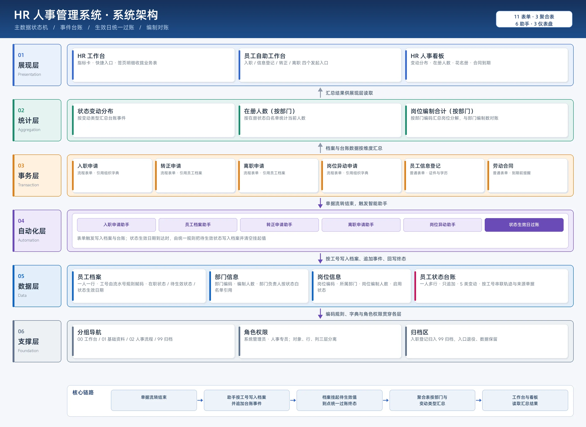
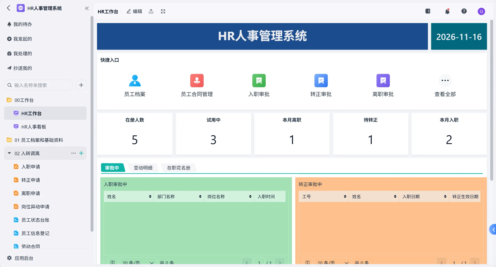
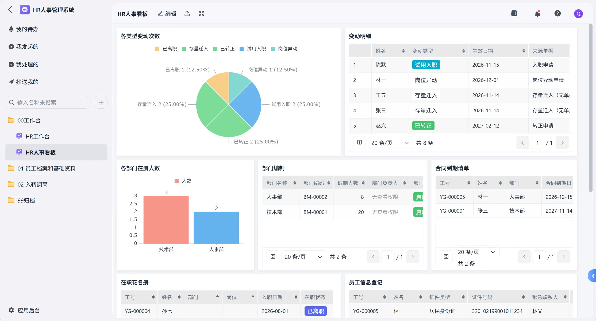
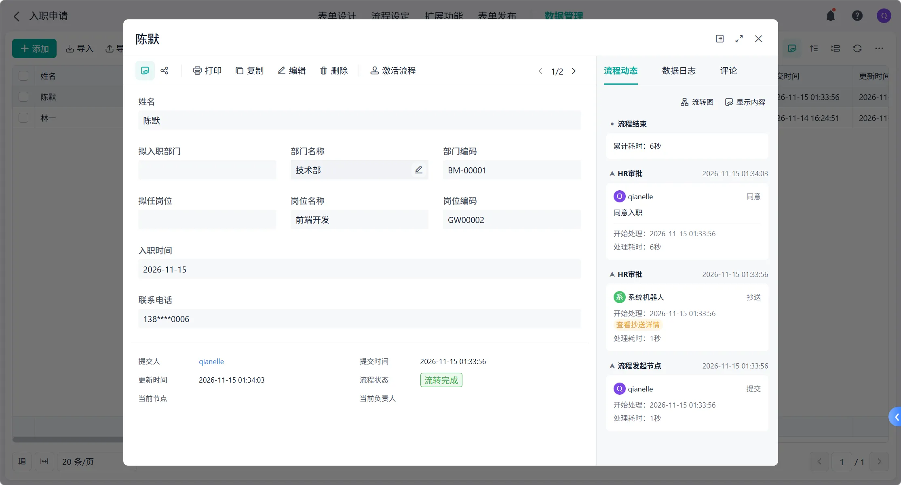
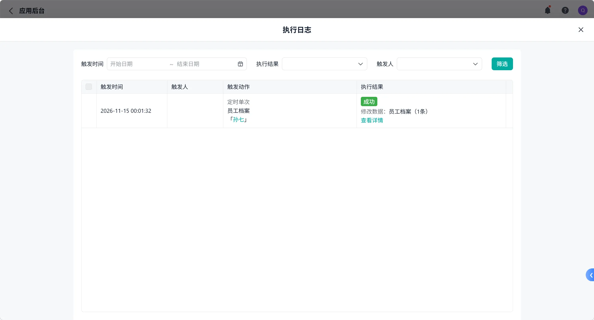
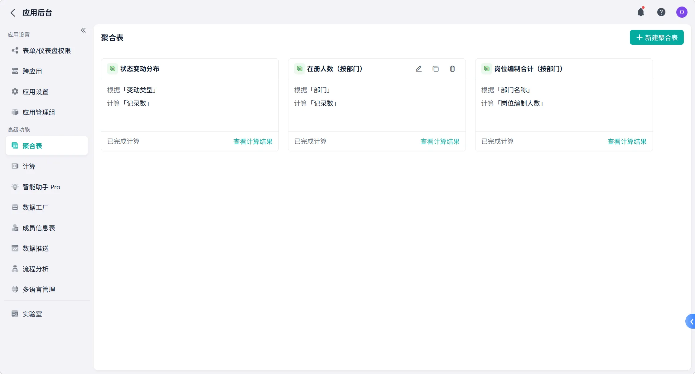

# HR 人事管理系统 · 状态机与事件台账

> 基于简道云低代码平台自主设计实现的业务型人事系统。以「一人一行的主数据 + 只追加的事件台账」为地基，把入职建档、审批过账、生效日状态切换、异动留痕与编制对账串成一条完整链路：单据流转结束，档案、台账、统计层各自归位。

***

## 目录

1. 项目概述
2. 功能一览
3. 系统架构
4. 数据模型
5. 核心设计：主数据状态机与事件台账
6. 自动化流程
7. 在册口径与编制对账模型
8. 页面与权限
9. 项目亮点
10. 运行示例
11. 技术栈与实现说明
12. 设计定位与演进方向
13. 附录：字段速查与作品截图位

***

## 01 项目概述

HR 人事管理系统面向单组织的人事全生命周期场景：入职建档、转正、离职、岗位异动、员工信息登记、劳动合同与组织编制管理。系统不依赖独立后端服务，全部能力由低代码平台的普通表单、流程表单、选择数据、智能助手、聚合表与仪表盘组合实现。

设计上遵循三条原则：

* **主数据唯一**：员工档案一人一行，工号由流水号规则赋码，是全系统唯一的寻址键；部门编码、岗位编码、合同编号同样由编码规则给出，人不参与赋码。
* **台账只追加，档案只覆盖**：事件台账逐笔记录「谁在何时发生了什么」，一人多行；员工档案记录「现在是什么」，一人一行。两者职责分离，轨迹可逐笔还原。
* **审批通过不等于状态生效**：审批写中间态并挂起待生效值，状态切换由生效日当天的统一规则完成，业务事实与状态时钟各归其位。

整套应用由 11 张表单、3 张聚合表、6 条智能助手、3 个仪表盘与 2 个角色组成，分组导航按「工作台 / 基础资料 / 人事流程 / 归档」组织，规模克制，链路完整。

***

## 02 功能一览

| **模块** | **功能**                       | **说明**                                  |
| ------ | ---------------------------- | --------------------------------------- |
| 基础资料   | 员工档案、部门信息、岗位信息               | 统一主数据与组织字典；含在职状态、待生效两列、部门编制数、岗位分解与状态白名单 |
| 业务单据   | 入职申请 / 转正申请 / 离职申请 / 岗位异动申请  | 流程表单；选择数据带出工号与归属，提交校验拦截非法日期与前后相同的异动     |
| 补充档案   | 员工信息登记、劳动合同                  | 证件、学历、紧急联系人与合同信息按工号挂回主数据，敏感字段脱敏显示       |
| 过账     | 审批通过写档案与台账                   | 智能助手按工号匹配，中间态与终态分两个时刻写入                 |
| 状态机    | 生效日统一过账                      | 定时规则按「状态生效日期」把待生效状态写入档案，并清空挂起值          |
| 事件台账   | 员工状态台账                       | 5 类变动、按工号串联一人多笔轨迹                       |
| 统计     | 状态变动分布、在册人数（按部门）、岗位编制合计（按部门） | 聚合表按维度计算，仪表盘组件分别取数                      |
| 页面     | HR 工作台、员工自助工作台、HR 人事看板       | 指标卡、快捷入口、签页容器收拢明细                       |
| 权限     | 系统管理员 / 人事专员                 | 对象、行、列三层分离；台账与主数据不对作业角色开放编辑             |

***

## 03 系统架构

##



**分组导航 4 个**：00 工作台、01 基础资料、02 入转离调。

**智能助手 6 条**：入职申请助手、员工档案助手、转正申请助手、离职申请助手、岗位异动助手、状态生效日过账。

**聚合表 3 张**：状态变动分布、在册人数（按部门）、岗位编制合计（按部门）。

**仪表盘 3 个**：HR 工作台、员工自助工作台、HR 人事看板。

**角色 2 个**：系统管理员、人事专员。

```
入职申请 ──审批通过──► 员工档案（新增，工号赋码，试用中）
                            │ 档案新增事件
                            ▼
                       员工状态台账（试用入职）

转正 / 离职申请 ─审批通过─► 员工档案（待转正 / 待离职
                              ＋ 待生效状态 ＋ 状态生效日期）
                            │
                            ▼
                       员工状态台账（已转正 / 已离职）

状态生效日期到达 ─► 状态生效日过账 ─► 员工档案（在职 / 已离职，挂起值清空）

岗位异动申请 ─审批通过─► 员工档案（部门 / 岗位）＋ 员工状态台账（岗位异动）

员工档案 / 员工状态台账 ─► 聚合表 ─► 仪表盘
```

***

## 04 数据模型

### 4.1 基础资料

**员工档案**（10 字段）

| **字段**  | **类型** | **说明**                        |
| ------- | ------ | ----------------------------- |
| 工号      | 流水号    | 唯一，按编码规则给出，全系统寻址键             |
| 姓名      | 单行文本   | 标题字段                          |
| 部门 / 岗位 | 单行文本   | 由入职助手与异动助手写入                  |
| 入职日期    | 日期     | 主数据事实，花名册与合同口径的基准             |
| 联系电话    | 单行文本   | 格式校验 + 字段安全脱敏显示               |
| 在职状态    | 下拉     | 试用中 / 待转正 / 在职 / 待离职 / 已离职，必填 |
| 待生效状态   | 下拉     | 试用中 / 在职 / 已离职，承载下一次状态切换的目标值  |
| 状态生效日期  | 日期     | 下一次状态切换的日历时点                  |
| 档案备注    | 多行文本   | 记录主数据字段的来源说明                  |

待生效两列由审批助手覆盖写入，同一工号只保留一组；档案备注记录主数据字段的来源说明，空缺字段保留原状并附来源注记。

**部门信息**（6 字段）

| **字段** | **类型**      | **说明**               |
| ------ | ----------- | -------------------- |
| 部门编码   | 流水号         | 唯一，按编码规则给出           |
| 部门名称   | 单行文本        | 不允许重复值               |
| 部门负责人  | 选择数据 → 员工档案 | 显示姓名 + 工号，按在职状态白名单筛选 |
| 负责人工号  | 单行文本        | 由部门负责人填充，取消可编辑       |
| 编制人数   | 数字          | 公司下达的部门编制数           |
| 部门状态   | 单选          | 启用 / 停用，字典筛选依据       |

**岗位信息**（7 字段）

| **字段** | **类型**      | **说明**                    |
| ------ | ----------- | ------------------------- |
| 岗位编码   | 流水号         | 唯一，按编码规则给出                |
| 岗位名称   | 单行文本        | 必填，不允许重复值                 |
| 所属部门   | 选择数据 → 部门信息 | 显示部门名称，数据过滤按部门状态筛选，填充部门编码 |
| 部门编码   | 单行文本        | 填充列，取消可编辑                 |
| 职级     | 下拉          | 初级 / 中级 / 高级 / 专家         |
| 岗位状态   | 单选          | 启用 / 停用                   |
| 岗位编制人数 | 数字          | 部门编制数在各岗位上的分解值            |

99归档分组保留历史入职登记表及其既有记录，供来源查阅，不参与业务链路。

### 4.2 入转调离

**入职申请**（流程表单，9 字段）

| **字段**      | **类型**      | **说明**                         |
| ----------- | ----------- | ------------------------------ |
| 姓名          | 单行文本        | 必填                             |
| 拟入职部门       | 选择数据 → 部门信息 | 显示部门名称，过滤部门状态 = 启用；填充部门名称、部门编码 |
| 部门名称 / 部门编码 | 单行文本        | 填充列，取消可编辑                      |
| 拟任岗位        | 选择数据 → 岗位信息 | 显示岗位名称，过滤岗位状态 = 启用；填充岗位名称、岗位编码 |
| 岗位名称 / 岗位编码 | 单行文本        | 填充列，取消可编辑                      |
| 入职时间        | 日期          | 由 HR 核定的到岗日                    |
| 联系电话        | 单行文本        | 格式校验 + 脱敏显示                    |

流程设为「发起 → HR 审批 → 结束」，节点操作含退回。人尚未建档，单据不预分配工号，引用的是两张组织字典。

**转正申请 / 离职申请 / 岗位异动申请**（流程表单，同构）

| **字段**                   | **类型**      | **说明**               |
| ------------------------ | ----------- | -------------------- |
| 员工                       | 选择数据 → 员工档案 | 显示姓名 + 工号，按在职状态白名单筛选 |
| 工号 / 姓名 / 入职日期           | 单行文本 / 日期   | 填充列，取消可编辑            |
| 转正生效日期 / 离职生效日期 / 异动生效日期 | 日期          | 核定的业务生效日，由助手写进台账与挂起值 |
| 说明 / 原因                  | 多行文本        | 审批留痕，写入台账备注          |
| 异动类型 / 新部门 / 新岗位         | 下拉 / 选择数据   | 岗位异动专用，分别引用字典并填充文本列  |

表单提交校验写合法条件、提示语与「阻止提交」：生效日不早于入职日期与当前日期，异动前后不得完全相同。校验只在提交时刻判定，既有记录不受影响。

**员工信息登记**（普通表单）

员工（选择数据 → 员工档案，白名单为试用中）、工号 / 姓名 / 部门 / 岗位 / 入职日期（填充列，取消可编辑）、证件类型（下拉）、证件号码（单行文本，不允许重复值 + 脱敏显示）、紧急联系人、紧急联系电话（单行文本，格式校验 + 脱敏显示）、学历（下拉）、核实备注（多行文本）。补充信息独立成表，按工号挂回主数据，主表字段保持稳定。

**劳动合同**（普通表单）

员工（选择数据 → 员工档案，白名单为试用中 / 待转正 / 在职）、工号 / 姓名 / 部门（填充列，取消可编辑）、合同编号（流水号）、合同类型（下拉）、签订日期、合同起始日、合同到期日（可空）、备注。校验条件为「合同到期日为空，或不早于合同起始日」；无固定期限合同的空值受合法条件放行。

### 4.3 账本层

**员工状态台账**（6 字段）

| **字段**  | **说明**                         |
| ------- | ------------------------------ |
| 工号 / 姓名 | 由触发数据写入，按工号挂回档案                |
| 变动类型    | 试用入职 / 已转正 / 已离职 / 存量迁入 / 岗位异动 |
| 生效日期    | 业务约定日，取单据上的核定日期                |
| 来源单据    | 取触发表单名称                        |
| 备注      | 取单据说明或原因                       |

台账只追加，不设编辑入口；同一工号的多笔事件按生效日期排列即为该员工的完整轨迹。

### 4.4 数据视图与组件筛选

| **视图 / 清单** | **所属对象**   | **筛选**               |
| ----------- | ---------- | -------------------- |
| 未办结清单       | 各流程表单      | 流程状态 不等于 流转完成        |
| 在职花名册       | 员工档案       | 按在职状态展示，含待生效两列       |
| 合同到期清单      | 劳动合同       | 按合同到期日升序             |
| 存量迁入起点      | 员工状态台账     | 变动类型 = 存量迁入          |
| 在册人数        | 聚合表        | 在职状态属于 4 个在册值，按部门分组  |
| 编制对账        | 部门信息 + 聚合表 | 部门编码对齐，展示编制数、分解合计与差额 |

***

## 05 核心设计：主数据状态机与事件台账

### 5.1 工号单一源头

工号不在单据侧预分配，由员工档案的流水号规则给出；部门编码、岗位编码、合同编号同理。所有「修改数据」动作以 `工号 等于 触发数据—工号` 定位主数据那一行。选择数据把主数据字段值写入单据后独立留存，主数据后续调整不改动既有单据；主数据与单据之间的一致性由工号这一条链承担，重名不影响定位。

### 5.2 台账只追加，档案只覆盖

```
员工档案（一人一行）          员工状态台账（一人多行）
 YG-000004 孙七  ──────────  已转正    2026-11-14
                 ──────────  已离职    2026-11-15
 YG-000005 林一  ──────────  试用入职  2026-11-14
                 ──────────  岗位异动  2026-12-01
 YG-000006 陈默  ──────────  试用入职  2026-11-15
```

同一工号在台账中可对应多笔事件；档案中该工号始终只有一行，由审批助手与生效日规则覆盖写入。事务单据的归档不影响台账既有事件，轨迹因此保持完整。

### 5.3 两段式状态机

```
审批通过 ─► 在职状态 = 待转正 / 待离职
            待生效状态 = 在职 / 已离职
            状态生效日期 = 核定生效日
                 │
                 ▼ 生效日 00:00
状态生效日过账 ─► 在职状态 = 触发数据—待生效状态
                待生效状态 / 状态生效日期 清空
```

设计价值：

* **最新由写入确定**：同一工号只有一组待生效值，后来发生的业务覆盖写入即代表当下有效的安排，无须比较日期，无须条件分支。
* **时钟挂在一人一行的档案上**：不挂在一人多行的台账上，同一员工的多笔生效日期不会互相驱动状态。
* **口径收敛**：状态目标以字段值形式存放在主数据行上，规则读取触发数据的字段值写入；新增事件类型只需在写台账助手里填入目标状态，规则数量不随之增长。

### 5.4 归属与状态分离

岗位异动只改部门与岗位，不写在职状态、不写待生效两列，因此不触发状态时钟。审批结束即更新归属，花名册实时可读；异动生效日作为业务事实留在单据与台账里，供薪资与编制口径查阅。

### 5.5 读数节奏分离

明细组件直连源表，刷新即取当前数据；聚合表按维度计算后保存结果，源表变化后由计算刷新更新。组件绑定聚合表时指标选求和，直连源表时指标选计数——同一指标名在两种数据源下含义相反，取值时按数据源判定。

***

## 06 自动化流程

### 6.1 状态机

```
试用中 ──转正审批通过──► 待转正 ──生效日──► 在职
   │                                        │
   └──────── 离职审批通过 ─► 待离职 ──生效日──► 已离职
```

### 6.2 入职链路（事件链）

```
入职申请·流程结束时
  → 新增数据：员工档案
      姓名 / 部门 / 岗位 / 入职日期 / 联系电话 取触发数据
      在职状态 = 试用中（固定值）
      工号由流水号规则给出，助手不写
  → 员工档案·新增数据时
      新增数据：员工状态台账
        工号 = 触发数据—工号（档案新增那条）
        变动类型 = 试用入职
        生效日期 = 触发数据—入职日期
        来源单据 = 触发数据—表单名称
        备注 = 入职审批通过建档
```

规则监听「档案新增」这个事实，让工号在赋码之后才进入台账，单据侧无须预赋码。写入分两段完成，每段各自读自己那一条触发数据，链路短且可审计。

### 6.3 审批过账

转正助手与离职助手结构相同：一条「新增数据」写台账事件，一条「修改数据」按工号匹配档案，写入中间态与待生效两列。岗位异动助手同样两动作，但「修改数据」只写部门与岗位。两条动作各写各的表，事件留痕与主数据当前态互不覆盖。

### 6.4 生效日统一过账

| **设置项**   | **值**                             |
| --------- | --------------------------------- |
| 触发时间类型    | 根据表单日期时间字段                        |
| 表单 / 日期字段 | 员工档案 · 状态生效日期                     |
| 时刻        | 当天 00:00                          |
| 重复触发      | 不重复触发                             |
| 触发条件      | 待生效状态 不为空                         |
| 动作        | 修改数据 → 员工档案                       |
| 匹配条件      | 工号 等于 触发数据—工号；在职状态 不等于 触发数据—待生效状态 |
| 设置字段值     | 在职状态 = 触发数据—待生效状态；待生效状态、状态生效日期 清空 |
| 无匹配记录时    | 不新增数据                             |

匹配条件中的当前状态判据形成幂等闸：已经落到目标状态的记录不再被写入，挂起值清空后该行不再有待生效安排。

### 6.5 提交校验与到期提醒

字段级校验（必填、不允许重复值、格式、脱敏）放在字段属性；跨字段的合法条件放在表单提交校验，配提示语与「阻止提交」。劳动合同的到期提醒由表单「扩展功能 → 推送提醒」承担：按合同到期日提前 30 天、只提醒一次，消息内容插入姓名、工号与合同到期日，不改写任何表单；看板同步提供按到期日升序的合同到期清单。

### 6.6 助手职责

| **助手**  | **触发**                           | **动作**      | **写入对象** |
| ------- | -------------------------------- | ----------- | -------- |
| 入职申请助手  | 入职申请 · 流程结束时                     | 新增数据        | 员工档案     |
| 员工档案助手  | 员工档案 · 新增数据时                     | 新增数据        | 员工状态台账   |
| 转正申请助手  | 转正申请 · 流程结束时                     | 新增数据 + 修改数据 | 台账 + 档案  |
| 离职申请助手  | 离职申请 · 流程结束时                     | 新增数据 + 修改数据 | 台账 + 档案  |
| 岗位异动助手  | 岗位异动申请 · 流程结束时                   | 新增数据 + 修改数据 | 台账 + 档案  |
| 状态生效日过账 | 员工档案 · 状态生效日期 · 当天 00:00 · 不重复触发 | 修改数据        | 员工档案     |

***

## 07 在册口径与编制对账模型

### 7.1 状态字典与在册口径

| **在职状态** | **业务时点**   | **计入在册** |
| -------- | ---------- | -------- |
| 试用中      | 录用生效、试用期起算 | 是        |
| 待转正      | 转正已批、生效日未到 | 是        |
| 在职       | 转正生效后      | 是        |
| 待离职      | 离职已批、生效日未到 | 是        |
| 已离职      | 离职生效后      | 否        |

审批通过不改变在册归属，生效日到达才退出在册口径，与两段式状态机保持同一时间轴。

### 7.2 计算模型

```
在册人数(部门)     = 计数(员工档案, 在职状态 ∈ {试用中, 待转正, 在职, 待离职}), 按部门分组
变动次数(类型)     = 计数(员工状态台账), 按变动类型分组
岗位编制合计(部门) = 求和(岗位信息.岗位编制人数), 按部门编码分组
配平差额           = 部门信息.编制人数 − 岗位编制合计
```

部门编制人数是公司下达的编制数，岗位编制人数是编制数在各岗位上的分解，两层业务对象各自独立保存。看板把编制数、分解合计与差额并排展示，配平状态一目了然；差额不为零时由 HR 在基础资料侧调整分解值。

### 7.3 绑定口径

「状态变动分布」按变动类型分组，指标为记录数，组件绑定该聚合表时指标选求和，得到各类事件的次数占比；「在册人数（按部门）」过滤掉不计入在册的状态值，组件同样选求和；直连源表的组件选计数。

***

## 08 页面与权限

### 8.1 HR 工作台（首页 · 作业与看数）

| **区域** | **内容**                                 |
| ------ | -------------------------------------- |
| 顶部     | 横幅图片组件、实时时间、业务导语                       |
| 指标卡 ×6 | 在册人数、试用中、待转正、本月入职、本月离职、未办结             |
| 快捷入口   | 员工档案、员工合同管理、入职审批、转正审批、离职审批、岗位异动审批、我的待办 |
| 待办视图   | 未办结清单按流程状态汇集待处理单据，为审批期间的并发提交提供核查依据     |
| 签页容器   | 审批中、变动明细、在职花名册                         |
| 底部     | 数据口径说明                                 |

快捷入口不提供主数据的直接新增，主数据只由入职审批链路产生。后台表单默认落在数据管理视图，新增作为显式按钮呈现。

### 8.2 员工自助工作台

横幅、说明文本、筛选条与快捷入口（入职申请、员工信息登记、转正申请、离职申请）。页面依据成员与工号绑定关系限定可见范围，员工仅可见本人单据；页面发布范围限定在应用内。

### 8.3 HR 人事看板（分析）

首屏保留饼图「各类型变动次数」与柱状图「各部门在册人数」，其余明细由签页容器收拢：变动明细、在职花名册、部门编制与岗位编制分解、合同到期清单、员工信息登记、未办结清单。图表按聚合表取数，明细按源表取数。

### 8.4 角色与权限

| **资源**        | **系统管理员** | **人事专员**        |
| ------------- | --------- | --------------- |
| 基础资料          | 全部权限      | 仅查看             |
| 业务单据          | 全部权限      | 查看、新增、编辑；无删除    |
| 员工档案 / 员工状态台账 | 全部权限      | 仅查看，无编辑、无新增、无删除 |
| 智能助手与页面配置     | 可配置       | 不可见             |
| 流程节点字段权限      | 可配置       | 发起人可填、审批人只读     |
| 证件与联系字段       | 按字段安全策略查看 | 脱敏显示            |
| 三个仪表盘         | 可见        | 可见              |

权限设计把「账本与主数据由规则写入」落到制度上：作业角色无法绕过过账直接改动档案状态或台账事件。

### 8.5 三层分离

对象层由表单发布范围与表单 / 仪表盘权限控制；列层由字段安全的脱敏显示与流程节点字段权限控制，且随节点变化（发起人可填、审批人只读）；行层由数据获取权限与成员—工号绑定过滤控制。后台表与看板发布范围限定在应用内，业务单据按角色开放填报。

***

## 09 项目亮点

1. **工号单一源头**：流水号规则在主数据侧赋码，全链路按工号寻址，重名不影响定位，单据侧不产生第二套编码。
2. **一人一行 + 只追加台账**：档案覆盖、台账追加，轨迹可逐笔还原，主数据始终只有一份当前态。
3. **两段式状态机 + 统一时钟**：审批写中间态、生效日写终态，时钟挂在档案上，一人一组待生效值，覆盖写入即最新，规则数量不随事件类型增长。
4. **计算与写入职责分离**：智能助手只负责按工号搬值，聚合表只负责按维度计算，仪表盘只负责呈现，任一层调整不牵动其余层。
5. **数据驱动的状态口径**：目标状态以字段值形式存放在主数据行上，规则读取触发数据的字段值写入，新增事件类型只改数据不改规则。
6. **角色化三页面与最小权限**：作业页、自助页、分析页分离，台账与主数据不对作业角色开放编辑，过账由规则完成。

***

## 10 运行示例

**初始**：员工档案中赵六为「试用中」、孙七为「待离职」并挂有待生效值 `已离职 / 2026-11-15`；台账按工号串联既有事件；聚合表按当前源数据保存计算结果。

| **顺序** | **业务**                   | **审批写入**                            | **生效日 00:00** | **台账** | **统计层**                  |
| ------ | ------------------------ | ----------------------------------- | ------------- | ------ | ------------------------ |
| 1      | 转正申请 · 赵六，生效日 2027-02-12 | 待转正；待生效状态 = 在职；状态生效日期 = 2027-02-12  | 到日变「在职」，两列清空  | 已转正一笔  | 在册人数不变                   |
| 2      | 离职申请 · 孙七，生效日 2026-11-15 | 待离职；待生效状态 = 已离职；状态生效日期 = 2026-11-15 | 到日变「已离职」，两列清空 | 已离职一笔  | 在册人数减一                   |
| 3      | 入职申请 · 陈默                | 档案新增 `YG-000006`，试用中，技术部 / 前端开发     | —             | 试用入职一笔 | 在册人数加一，技术部加一             |
| 4      | 岗位异动 · 林一，技术部 → 人事部      | 部门与岗位即时更新，状态与待生效两列不动                | —             | 岗位异动一笔 | 部门分布重排，总数不变              |
| 5      | 计算刷新                     | —                                   | —             | —      | 三张聚合表按当前源数据更新，饼图与柱状图随之呈现 |

状态相关业务中，审批与生效分别落在两个时刻；台账只记录已发生的事件，不因状态切换追加记录；明细组件直连源表实时呈现，图表读取计算后的结果。

***

## 11 技术栈与实现说明

| **层** | **技术 / 能力**                                            |
| ----- | ------------------------------------------------------ |
| 平台    | 简道云低代码平台（SaaS）                                         |
| 数据建模  | 普通表单、流程表单、选择数据与字段填充、流水号、下拉与单选、日期、数字、公式字段、字段权限、字段安全、聚合表 |
| 逻辑层   | 智能助手（表单触发 / 定时触发 / 新增数据 / 修改数据）、表单提交校验、推送提醒            |
| 交互层   | 仪表盘（统计表、明细表、图片组件、文本组件、实时时间、快捷入口、布局容器）、流程节点字段权限、表单发布范围  |
| 权限层   | 角色、表单 / 仪表盘权限、节点字段权限、脱敏显示、数据获取权限                       |
| 后端    | 无自建服务，无外部服务依赖                                          |

智能助手只承担字段值的搬运与状态推进，聚合表只承担分组计算，仪表盘只承担呈现；每个写动作落在规则画布上，逐条可查。

***

## 12 设计定位与演进方向

**定位**：面向单组织的人事全生命周期系统，以员工档案为主数据、事件台账为轨迹、状态机为时钟，把入职建档、审批过账、生效日切换与统计对账串成一条短而完整的链路。这个范围适合讲清「主数据建模 → 按工号过账 → 可追溯轨迹」这条主线。

**演进方向**：

* **成员身份与工号绑定**：由当前成员带出工号，自助页面按绑定关系限定可见范围，形成员工本人填报的完整闭环。
* **意向日期与核定日期分列**：申请人填写预计日期，HR 在审批节点核定生效日，两类日期各归其人。
* **统一入转调离单据**：以异动类型分支承载四类业务，配合流程分支与节点级字段权限。
* **组织与人力扩展**：合同续签与终止、考勤与请假、绩效、薪酬、招聘模块接入同一工号体系。
* **统计深化**：部门编制数与在册实占双系列图、跨表数据加工、按部门与岗位的多维人力结构分析。
* **批量迁入与归档策略**：存量人员由结构化文件收编并同步生成起始事件，凭证保留规则固化为制度。

***

## 13 附录

### 13.1 字段速查

| **表**  | **关键字段**                                           |
| ------ | -------------------------------------------------- |
| 员工档案   | 工号、姓名、部门、岗位、入职日期、联系电话、在职状态、待生效状态、状态生效日期、档案备注       |
| 部门信息   | 部门编码、部门名称、部门负责人、负责人工号、编制人数、部门状态                    |
| 岗位信息   | 岗位编码、岗位名称、所属部门、部门编码、职级、岗位状态、岗位编制人数                 |
| 入职申请   | 姓名、拟入职部门、部门名称、部门编码、拟任岗位、岗位名称、岗位编码、入职时间、联系电话        |
| 转正申请   | 员工、工号、姓名、入职日期、转正生效日期、转正说明、转正意见、流程状态                |
| 离职申请   | 员工、工号、姓名、入职日期、离职生效日期、离职原因、流程状态                     |
| 岗位异动申请 | 员工、工号、姓名、原部门、原岗位、异动类型、新部门、新岗位、异动生效日期、异动原因          |
| 员工信息登记 | 员工、工号、姓名、部门、岗位、入职日期、证件类型、证件号码、紧急联系人、紧急联系电话、学历、核实备注 |
| 劳动合同   | 员工、工号、姓名、部门、合同编号、合同类型、签订日期、合同起始日、合同到期日、备注          |
| 员工状态台账 | 工号、姓名、变动类型、生效日期、来源单据、备注                            |
| 聚合表    | 状态变动分布、在册人数（按部门）、岗位编制合计（按部门）                       |

### 13.2 作品截图位

HR 工作台 · 指标卡与快捷入口



HR 人事看板 · 状态分布与在册人数



入职申请 · 流程动态



数据日志 · 生效日过账留痕



​

状态生效日过账 · 定时触发与修改数据


聚合表&#x20;



​
