# 轻进销存 · 链式账本

> 基于明道云低代码平台自主设计实现的轻量进销存系统。以「链式库存流水」为核心，把单据审核、库存校验、台账回写与补货测算串成一条自动链路：单据一点提交，账本自己记完。

***

## 目录

1. 项目概述
2. 功能一览
3. 系统架构
4. 数据模型
5. 核心设计：链式账本
6. 自动化流程
7. 补货建议模型
8. 页面与权限
9. 项目亮点
10. 运行示例
11. 技术栈与实现说明
12. 设计定位与演进方向
13. 附录：字段速查与作品截图位

***

## 01 项目概述

轻量进销存面向单仓、单品类的日常存货管理场景：商品入库、出库、台账查询、低库存提醒与补货测算。系统不依赖独立后端服务，全部能力由低代码平台的工作表、关联关系、自定义页面、工作流与 Python 代码块组合实现。

设计上遵循三条原则：

* **关系建在明细侧**：每张明细都持有指向父单的双向关联，过账时按当前单据精确取行，历史数据不会混入计算。
* **账本只存结果，流水保留过程**：库存台账保存每个商品在每个仓库的当前结存；库存流水逐笔保存「前结存 → 变动量 → 后结存」，台账即流水链的链尾快照。
* **凭证不做物理删除**：作废单据改状态并备注留痕，保证来源单号链完整可追溯。

整套应用由 9 张工作表、3 条工作流、2 个自定义页面与 2 个角色组成，规模克制，链路完整。

***

## 02 功能一览

| **模块** | **功能**           | **说明**                                        |
| ------ | ---------------- | --------------------------------------------- |
| 基础资料   | 商品档案、仓库、往来单位     | 统一主数据，商品含安全库存、采购提前期与流程写入的派生字段                 |
| 业务单据   | 入库单 / 出库单 + 各自明细 | 自动编号、四态流转、双向关联明细、金额小计公式、合计统计行                 |
| 过账     | 提交审核自动过账         | Python 合并求和 + 库存充足性校验，不足整单阻断，通过则写流水、回写台账、推进状态 |
| 账本     | 库存台账、库存流水        | 链式结存、链式校验公式、异常视图哨兵                            |
| 补货     | 补货建议测算           | 按近 30 天消耗、采购提前期与安全库存算建议采购量，写回商品档案             |
| 看板     | 进销存总览            | 库存总量、低库存数、今日出库、链式异常四个指标 + 清单与变动图              |
| 作业     | 业务办理工作台          | 快捷发起、待审核待办、账本异常核查                             |
| 权限     | 管理员 / 仓管员        | 账本不可编辑不可删除，作业与查看分离                            |

***

## 03 系统架构

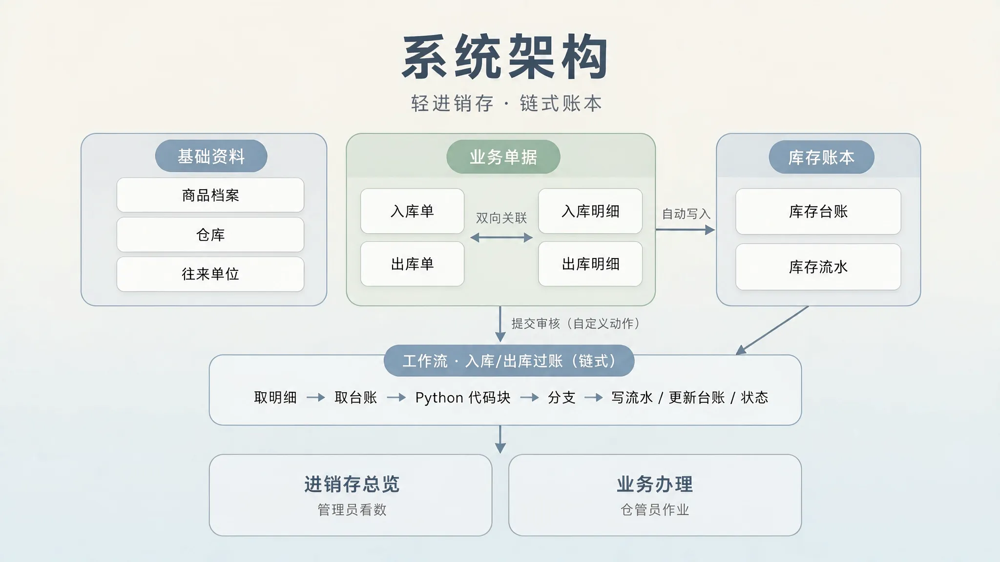

**工作流 3 条**：出库单过账（链式）、入库单过账（链式）、商品档案 · 重算补货建议。

**自定义动作 3 个**：出库单「提交审核」、入库单「提交审核」、商品档案「重算补货建议」。

**页面 2 个**：进销存总览（首页）、业务办理。

**角色 2 个**：系统管理员、仓管员。

***

## 04 数据模型

### 4.1 基础资料

**商品档案**（14 字段）

| **字段**           | **类型**       | **说明**              |
| ---------------- | ------------ | ------------------- |
| 商品编码             | 文本           | 唯一，不允许重复            |
| 商品名称             | 文本           | 标题字段                |
| 商品分类 / 计量单位 / 规格 | 单选 / 单选 / 文本 | 主数据描述               |
| 参考进价 / 参考售价      | 金额           | 默认 0                |
| 安全库存             | 数值           | 预警判定基准              |
| 默认仓库 / 默认库位      | 关联记录 / 文本    | 单据录入默认值，不参与库存判定     |
| 商品状态             | 单选           | 在用 / 停用，关联字段按「在用」筛选 |
| 日均消耗 / 建议采购量     | 数值           | 由补货建议流程写入，界面只读      |
| 采购提前期(天)         | 数值           | 补货模型参数，按商品维护        |
| 备注               | 多行文本         | ​                   |

**仓库**（6 字段）：仓库编码（唯一）、仓库名称、仓库类型、仓库状态、仓库地址、备注。

**往来单位**（7 字段）：单位编码（唯一）、单位名称、单位类型（供应商 / 客户 / 两者）、合作状态、联系人、联系电话、备注。供应商与客户合并为一张表，减少重复结构。

### 4.2 业务单据

**入库单 / 出库单**（同构）

| **字段**      | **类型**   | **说明**                                |
| ----------- | -------- | ------------------------------------- |
| 单据编号        | 自动编号     | `RK-/CK-YYYYMMDD-3位`，按日重置             |
| 单据类型        | 单选       | 采购入库 / 退货入库 / 其他入库；销售出库 / 领用出库 / 其他出库 |
| 单据状态        | 单选       | 草稿 / 待审核 / 已审核 / 已取消，默认草稿、新增时隐藏       |
| 往来单位        | 关联记录     | 按合作状态筛选                               |
| 收货仓库 / 发货仓库 | 关联记录     | 按仓库状态筛选                               |
| 仓库编码        | 他表字段     | 由仓库带出，供流程引用                           |
| 单据日期        | 日期       | 默认此刻                                  |
| 备注          | 多行文本     | 过账结果与阻断提示写入此处                         |
| 明细行         | 关联记录（多条） | 双向关联，表格展示，带合计统计行                      |

**入库明细 / 出库明细**

| **字段**        | **类型**  | **说明**             |
| ------------- | ------- | ------------------ |
| 所属入库单 / 所属出库单 | 关联记录    | 双向关联自动生成，按当前单据精确取行 |
| 商品            | 关联记录    | 按商品状态筛选            |
| 商品编码          | 他表字段    | 由商品档案带出并存储         |
| 数量 / 单价       | 数值 / 金额 | ​                  |
| 金额小计          | 公式      | 数量 × 单价            |
| 行备注           | 文本      | ​                  |

### 4.3 库存账本

**库存台账**（一商品 × 一仓 = 一行）

| **字段**      | **说明**                   |
| ----------- | ------------------------ |
| 商品 / 仓库     | 关联记录，账本维度                |
| 商品编码 / 仓库编码 | 他表字段，用于匹配定位              |
| 当前数量        | 由过账流程写入，界面不对作业角色开放编辑     |
| 安全库存        | 由商品档案带出，展示用              |
| 库存预警        | 单选：正常 / 低库存 / 缺货，由过账流程写入 |
| 最近变动时间      | 由过账流程写入                  |
| 备注          | ​                        |

**库存流水**（链式账本本体）

| **字段**          | **说明**                    |
| --------------- | ------------------------- |
| 来源单号            | 对应入库 / 出库单编号，保证链完整        |
| 商品 / 仓库         | 关联记录，界面按标题字段渲染名称          |
| 行序号             | 单据内顺序                     |
| 前结存 / 变动量 / 后结存 | 链式三元组，入库为正、出库为负           |
| 链式校验            | 公式：前结存 + 变动量 − 后结存，正常恒为 0 |
| 变动时间            | 流程写入当前时间                  |
| 行备注             | ​                         |

### 4.4 视图

| **视图** | **所属表**   | **筛选**     |
| ------ | --------- | ---------- |
| 补货建议清单 | 商品档案      | 建议采购量 > 0  |
| 低库存预警  | 库存台账      | 库存预警 ≠ 正常  |
| 链式异常   | 库存流水      | 链式校验 ≠ 0   |
| 待审核    | 入库单 / 出库单 | 单据状态 = 待审核 |

***

## 05 核心设计：链式账本

普通流水只记录「变动 −6」，当前结存要靠全表求和反推。链式流水让每一笔自带余额，并与上一笔首尾相接：

```
本笔前结存  →  变动量  →  本笔后结存
                 ↑            │
                 └── 下一笔前结存
```

**示例：同一商品两行出库各 3，台账起始 10**

| **业务**       | **前结存** | **变动量** | **后结存** |
| ------------ | ------- | ------- | ------- |
| 出库（3 + 3 合并） | 10      | −6      | **4**   |

台账最终值为 4，正是这条链的链尾。每一笔流水都满足 `前结存 + 变动量 − 后结存 = 0`，由公式字段「链式校验」实时计算；「链式异常」视图筛选出校验不为 0 的记录，作为账本健康度哨兵——正常状态下该视图为空，一旦出现记录即表示链断。

设计价值：

* **账实可回溯**：台账是快照，流水是路径，任何时刻都能逐笔还原结存怎么走到当前值。
* **错误可见**：状态改了但库存没动这类隐性不一致，会直接落成一条校验异常，而不是藏在日志里。
* **单据级合并**：一张单据的多行明细先按商品合并求和，再生成一笔流水，避免逐行独立校验造成的重复扣减或漏扣。

***

## 06 自动化流程

### 6.1 单据状态机

```
草稿 ──提交审核──► 待审核 ──过账通过──► 已审核
  │                  │
  └──────────────────┴── 作废 ──► 已取消（不改库存，备注留痕）
```

状态字段在新建表单中隐藏，用户不手动维护：新建即草稿，点「提交审核」后流程先推至待审核；校验不足停在待审核并写入阻断提示，通过后推进已审核。已审核单据不再出现在提交审核按钮的可用范围内。

### 6.2 出库单过账（链式）

**触发**：出库单详情页的「提交审核」自定义动作（带二次确认）。

**节点链**

```
按钮触发
  → 更新记录：单据状态 = 待审核
  → 获取多条记录：取出库明细      [所属出库单 = 当前记录]
  → 获取多条记录：取库存台账
  → 代码块（Python）：合并求和 + 充足性校验 + 链式计算
  → 分支：阻断提示是否为空
      ├ 不足 → 更新记录：写阻断提示（状态保持待审核）
      └ 通过 → 新增记录：写库存流水
             → 更新记录：回写库存台账（当前数量、库存预警、最近变动时间）
             → 更新记录：单据状态 = 已审核
```

**Python 代码块接口**

| **​** | **内容**                                           |
| ----- | ------------------------------------------------ |
| 运行环境  | 明道云 Python 3.7.5                                 |
| 输入    | 明细数量列、台账当前数量列、单据编号、仓库编码（保持单列 / 单值，避免多行对象耦合）      |
| 处理    | 多行数量合并求和 → 与台账结存比对 → 不足生成阻断提示；充足则算前结存、变动量、后结存与预警 |
| 输出    | 阻断提示、单号、前结存、变动量、后结存、库存预警等标量，由下游节点逐字段引用           |
| 方向常量  | `DIRECTION = -1`（出库减库存）                          |

代码块只负责计算，写库全部由工作流节点完成，职责清晰。取不到数据时整单阻断，不会误放行走扣减。

### 6.3 入库单过账（链式）

与出库共用同一段 Python 代码，仅将方向常量改为 `DIRECTION = +1`，并将取数对象换为入库单 / 入库明细、来源单号换为入库单编号。入库只做加法、不设库存上限校验；其余分支、流水结构与台账回写完全一致。**一套代码覆盖一加一减**，是本项目的关键复用点。

### 6.4 商品档案 · 重算补货建议

按钮触发，取近 30 天出库流水与当前台账，计算后写回商品档案的「日均消耗」「建议采购量」。该流程不写台账、不写流水、不生成采购单，对账本零副作用。

***

## 07 补货建议模型

不做「低于阈值就报警」，而是按消耗速率与采购提前期测算未来应备库存：

```
日均消耗   = 近 30 天出库总量 ÷ 30
目标库存   = 日均消耗 × (采购提前期 + 到货缓冲 3 天) × 波动系数 1.5 + 安全库存
峰值保护   = 单笔最大出库量 + 安全库存        （防止大单被平均值抹平）
建议采购量 = max(0, max(目标库存, 峰值保护) − 当前库存)
```

| **参数** | **值** | **来源** |
| ------ | ----- | ------ |
| 统计窗口   | 30 天  | 模型常量   |
| 到货缓冲   | 3 天   | 模型常量   |
| 波动系数   | 1.5   | 模型常量   |
| 采购提前期  | 按商品维护 | 商品档案字段 |
| 安全库存   | 按商品维护 | 商品档案字段 |

输出写回「日均消耗」「建议采购量」，并可通过「补货建议清单」视图直接查看需补货商品。建议量仅作决策参考，不自动改变库存。

***

## 08 页面与权限

### 8.1 进销存总览（首页 · 看数）

| **组件** | **内容**                     |
| ------ | -------------------------- |
| 数值卡 ×4 | 当前库存总量、低库存商品数、今日出库单、链式异常笔数 |
| 清单 ×2  | 补货建议清单、库存台账快照              |
| 图表     | 单据级库存变动（入库为正、出库为负）         |
| 说明     | 页面底部业务数据口径                 |

「链式异常笔数」是账本健康度仪表，正常恒为 0。

### 8.2 业务办理（作业工作台）

| **区域** | **内容**                   |
| ------ | ------------------------ |
| 顶部     | 作业导语与凭证保留原则              |
| 快捷发起   | 新建入库单 / 新建出库单            |
| 待审核待办  | 出库单 · 待审核、入库单 · 待审核 两个视图 |
| 异常核查   | 链式异常、低库存预警 两个视图          |
| 底部     | 数据口径说明                   |

提交审核在单据详情页完成，工作台只承担入口与待办聚合。

### 8.3 角色与权限

| **资源**         | **系统管理员** | **仓管员**             |
| -------------- | --------- | ------------------- |
| 基础资料           | 全部权限      | 仅查看                 |
| 入库单 / 出库单 / 明细 | 全部权限      | 查看、新增、编辑；无删除        |
| 库存台账 / 库存流水    | 全部权限      | **仅查看，无编辑、无新增、无删除** |
| 自定义动作          | 全部        | 提交审核、重算补货建议         |
| 页面与流程配置        | 可配置       | 不可见                 |
| 进销存总览 / 业务办理   | 可见        | 可见                  |

权限设计把「账本由流程写入」落到制度上：作业角色无法手工改台账数量或删除凭证，杜绝绕过过账直接改数。

***

## 09 项目亮点

1. **双向关联地基**：明细表持有指向父单的真实关联字段，过账按当前单据精确取行，从结构上避免全表扫描历史明细。
2. **链式账本 + 自动哨兵**：前结存 / 变动量 / 后结存三元组配合公式校验与异常视图，把账实不一致从隐性变成可见。
3. **一次代码双向复用**：出入库共用同一 Python 代码块，仅切换方向常量，逻辑零重复。
4. **补货建议而非阈值报警**：引入消耗速率、提前期、波动系数与峰值保护，形成可解释的测算模型。
5. **最小接口原则**：代码块只接收单列数值与单值参数，输出标量结果，写库交给节点，降低平台数据序列化带来的耦合。
6. **角色化双页面**：看数页与干活页分离，配合最小权限，形成完整的使用闭环。

***

## 10 运行示例

初始：库存台账 `复印纸 / 仓库1 / 当前数量 10 / 安全库存 5 / 正常`。

| **顺序** | **单据** | **明细**         | **前结存** | **变动量** | **后结存** | **台账预警**    |
| ------ | ------ | -------------- | ------- | ------- | ------- | ----------- |
| 1      | 出库单    | 同商品两行各 3（合计 6） | 10      | −6      | 4       | 低库存（4 \< 5） |
| 2      | 出库单    | 同商品两行各 1（合计 2） | 4       | −2      | 2       | 低库存         |
| 3      | 入库单    | 同商品两行各 3（合计 6） | 2       | +6      | 8       | 正常（8 ≥ 5）   |

三笔流水的链式校验均为 0，台账链尾 8 与最后一笔后结存一致。若提交一张合计 12 的出库单，系统会整单阻断：状态保持待审核、备注写入「现有 8，本次 12，缺 4」，不写流水、不扣台账。

***

## 11 技术栈与实现说明

| **层** | **技术 / 能力**                                |
| ----- | ------------------------------------------ |
| 平台    | 明道云低代码平台（SaaS）                             |
| 数据建模  | 工作表、关联记录（单条 / 多条 / 双向关联）、他表字段、公式字段、自动编号、视图 |
| 逻辑层   | 工作流 + Python 代码块（Python 3.7.5）             |
| 交互层   | 自定义动作（按钮触发 + 二次确认）、自定义页面、组件与视图绑定           |
| 权限层   | 角色、应用项分发、逐表数据操作权限                          |
| 后端    | 无自建服务、无外部接口依赖                              |

Python 代码块仅用于纯计算（合并求和、充足性校验、链式结存、补货测算），不直接操作数据库；所有写入由平台的「新增记录 / 更新记录」节点完成，便于在流程画布中审计每个写动作。

***

## 12 设计定位与演进方向

**定位**：面向单仓、单品类的轻量进销存演示系统。单据按单一商品、单一仓库组织，同商品多行明细先合并再过账，账本以「商品 × 仓库」一行承载。这个范围让链路保持短而完整，适合讲清「关系建模 → 自动过账 → 可追溯账本」这条主线。

**演进方向**：

* 台账按商品与仓库精确定位，并在无对应行时自动建行，支撑多商品多仓；
* 补货建议改为定时任务批量重算，覆盖全量商品；
* 引入审批人、审核意见与驳回重提，形成多人协作的审核链；
* 流水按明细行逐笔拆分，进一步细化批次与库位维度的追溯。

***

## 13 附录

### 13.1 字段速查

| **表**       | **关键字段**                                    |
| ----------- | ------------------------------------------- |
| 商品档案        | 商品编码、商品名称、安全库存、默认仓库、默认库位、日均消耗、建议采购量、采购提前期   |
| 仓库          | 仓库编码、仓库名称、仓库类型、仓库状态、仓库地址                    |
| 往来单位        | 单位编码、单位名称、单位类型、合作状态                         |
| 入库单 / 出库单   | 单据编号、单据类型、单据状态、往来单位、收/发货仓库、仓库编码、单据日期、备注、明细行 |
| 入库明细 / 出库明细 | 所属单据、商品、商品编码、数量、单价、金额小计、行备注                 |
| 库存台账        | 商品、仓库、商品编码、仓库编码、当前数量、安全库存、库存预警、最近变动时间       |
| 库存流水        | 来源单号、商品、仓库、行序号、前结存、变动量、后结存、链式校验、变动时间        |

### 13.2 作品截图位

1. 应用首页 · 进销存总览（四张指标卡 + 清单 + 变动图）

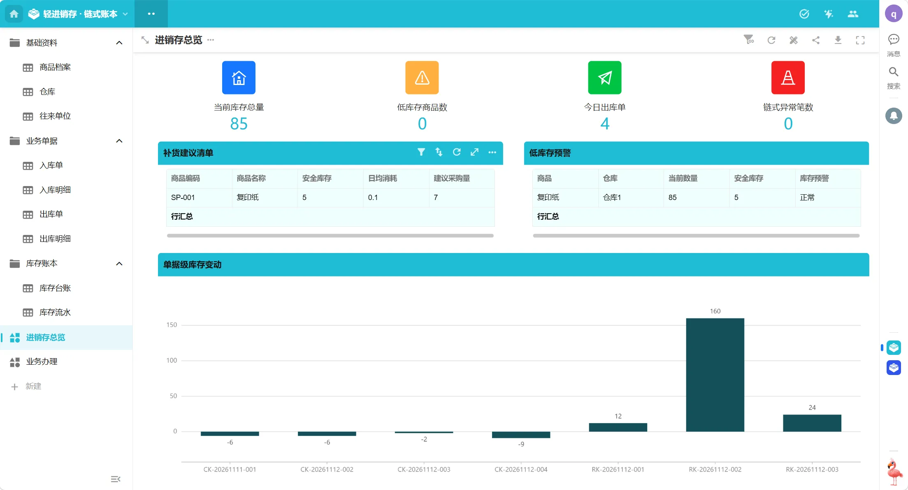

2. 业务办理工作台（快捷发起 + 待审核待办 + 异常核查）

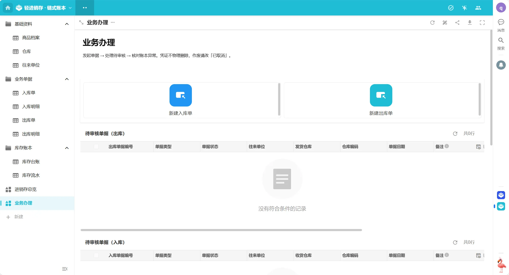

3. 商品档案详情（补货建议按钮、日均消耗与建议采购量）

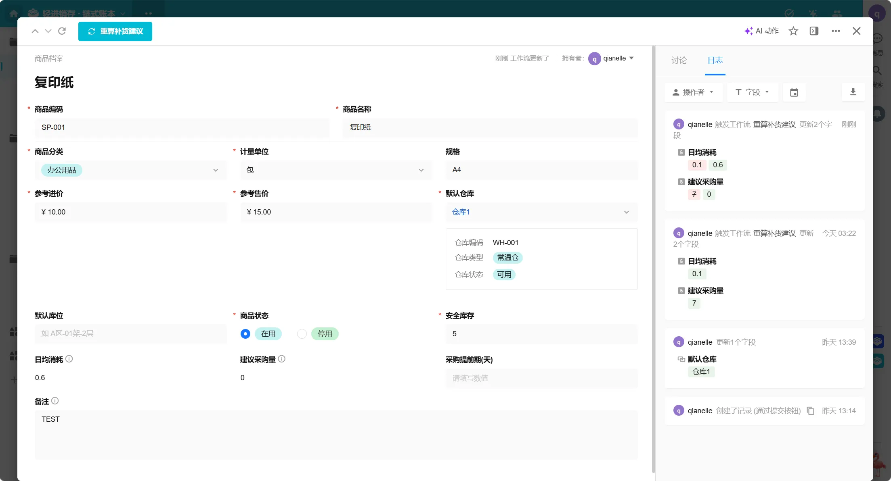

4. 出库单详情（状态流转、明细双向关联、合计统计行）

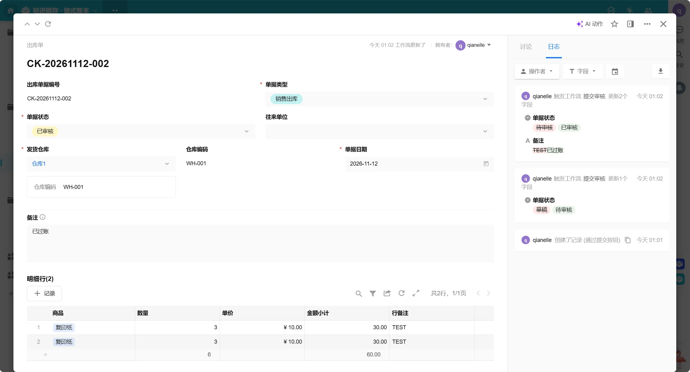

5. 入库单详情（自动编号、明细行、过账结果）

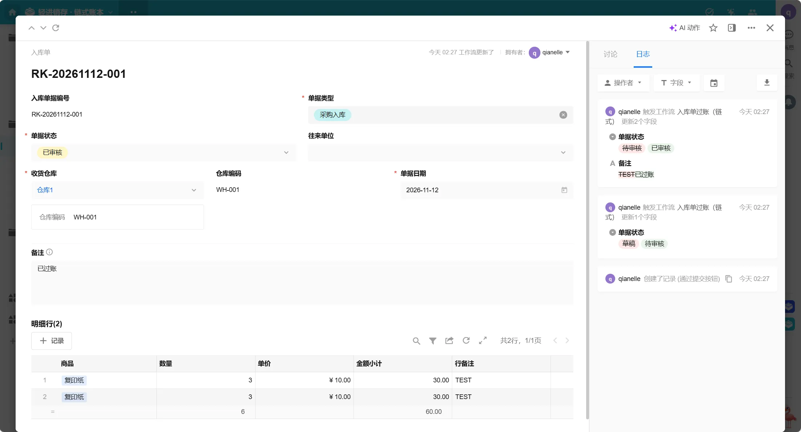

6. 库存台账详情（当前数量、库存预警、最近变动时间）

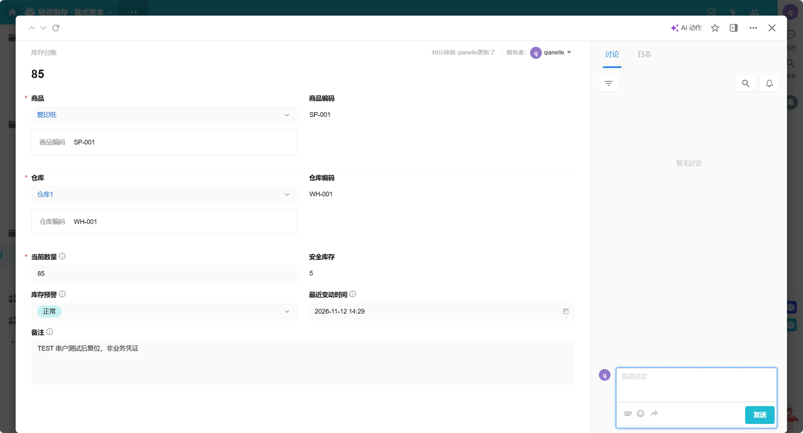

7. 库存流水详情（链式三元组、链式校验 0）

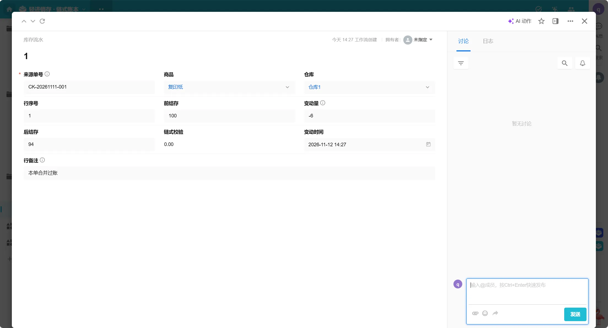

8. 工作流画布 · 出库单过账（节点链与分支）

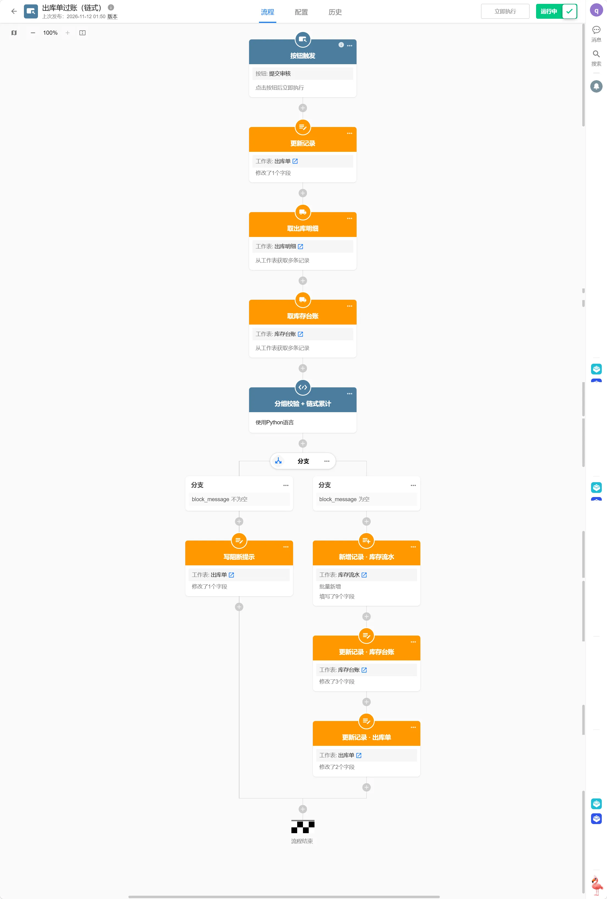

9. Python 代码块配置（输入输出定义）

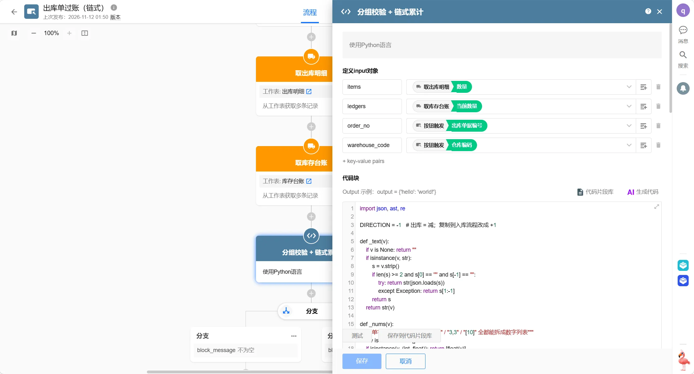

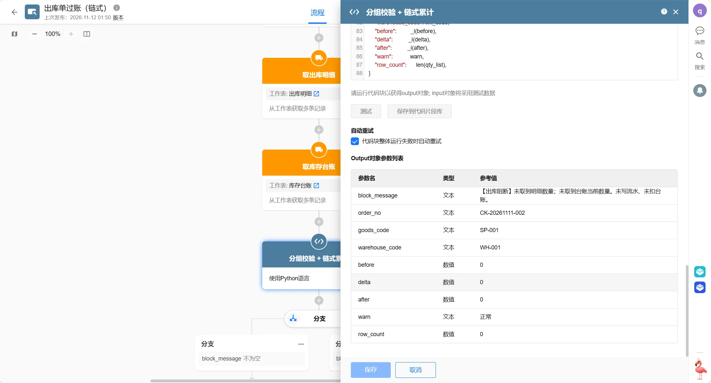

10. 角色权限 · 仓管员逐表分发

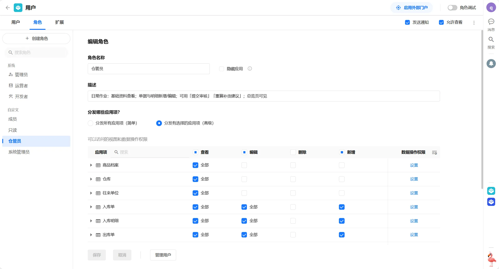

​
