# 通用进销存管理系统

> 基于明道云低代码平台自主设计实现的通用进销存系统。以采购、销售、库存三条主线组织业务，用 19 张工作表、21 条自动化工作流与 2 个自定义页面，把采购下单 → 入库过账 → 销售出库 → 盘点调整 → 对账红冲 → 低库存预警串成一条完整链路：单据审核通过，台账与流水自动同步，账目随时可回溯。

***

## 目录

1. 项目概述
2. 功能一览
3. 系统架构
4. 数据模型
5. 核心设计：整单分组校验与跨层汇总
6. 自动化流程
7. 低库存预警模型
8. 页面与权限
9. 项目亮点
10. 运行示例
11. 技术栈与实现说明
12. 设计定位与演进方向
13. 附录：字段速查与界面图

***

## 01 项目概述

通用进销存管理系统面向多商品、多仓库、多往来单位的日常存货管理场景，覆盖采购订单、入库、销售订单、出库、盘点、对账红冲与库存预警全链路。系统不依赖独立后端服务，全部能力由低代码平台的工作表、关联关系、汇总与查找引用字段、公式字段、自定义页面与工作流组合实现。

设计上遵循三条原则：

* **主子表分层**：主表承载单据头与审核信息，明细子表承载行项目，主表用汇总字段得出总数量与总金额，不设手工合计，避免两处数字不一致。
* **单一维护源**：安全库存只在商品档案维护，台账通过查找引用带出；库存预警只在商品档案跨仓汇总层级判定并写入，台账不反向回写，消除多仓之间的数值覆盖。
* **凭证不物理删除**：作废单据改状态并备注留痕，过账差错走红冲冲销并记录在案，保证库存流水的来源单号链完整可追溯。

整套应用由 19 张工作表（14 主表 + 5 子表、213 个字段，其中平台派生字段 81 个、录入类业务字段 132 个）、21 条工作流、9 个自定义动作、2 个自定义页面、4 个业务角色与 5 个导航分组组成，结构完整、职责分明。

***

## 02 功能一览

| **模块** | **功能**                    | **说明**                            |
| ------ | ------------------------- | --------------------------------- |
| 基础资料   | 商品档案、供应商、客户、仓库            | 统一主数据；商品含安全库存、跨仓汇总与预警，仓库含当前库存总量   |
| 采购业务   | 采购订单 / 采购明细、入库单 / 入库明细    | 自动编号、四态流转、金额小计公式、总数量与总金额汇总、上游单据关联 |
| 销售业务   | 销售订单 / 销售明细、出库单 / 出库明细    | 与采购侧结构镜像；出库前置库存充足性校验，不足整单阻断       |
| 库存账本   | 库存台账、库存流水、盘点单 / 盘点明细      | 台账按商品 × 仓库记录当前数量，流水逐笔留痕，盘点差异逐行调整  |
| 对账与红冲  | 库存对账记录、库存红冲记录             | 每日定时对账核对台账与流水；过账差错通过红冲冲销反向回补并留痕   |
| 待办聚合   | 待审核工单                     | 三条同步流程把五张单据表的待审核记录实时归集到一张汇总表      |
| 自动化    | 21 条工作流                   | W1–W4 四条主流程，守卫、汇总同步、对账红冲与子流程各司其职  |
| 预警     | 商品档案低库存预警                 | 以跨仓汇总值与安全库存比对，总览页直接呈现预警清单         |
| 页面     | 库存总览、业务办理                 | 看数页与作业页分离，配合角色权限形成使用闭环            |
| 权限     | 系统管理员 / 采购员 / 销售员 / 仓库管理员 | 应用项、记录范围、字段三级权限，凭证不可物理删除          |

***

## 03 系统架构

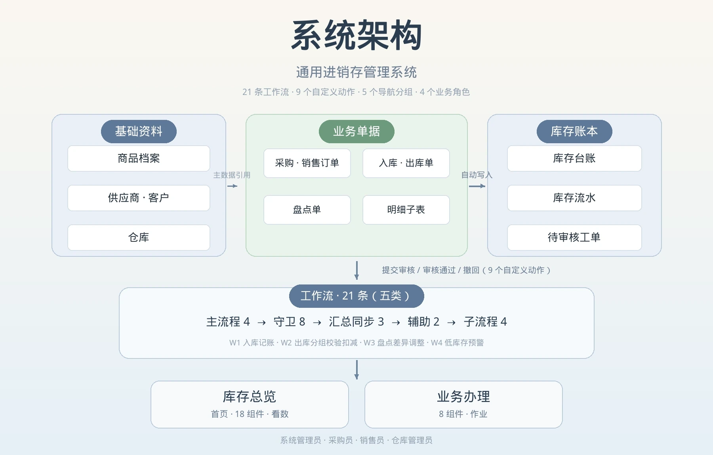

**工作流 21 条**（全部为已发布状态），按职责分五类：

* **主流程 4 条**：W1 入库记账、W2 出库分组校验扣减、W3 盘点差异调整、W4 低库存预警；
* **守卫流程 8 条**：围绕入库单与盘点单，拦截提交校验、仓库变更、明细变更、明细删除四类越权改动；
* **汇总同步 3 条**：把五张单据表的待审核记录变化实时归集到「待审核工单」汇总表；
* **辅助流程 2 条**：每日库存对账（定时触发）、库存红冲冲销；
* **子流程 4 条**：台账累加、分组扣减、台账建行、台账调整，供主流程遍历调用。

**自定义动作 9 个**：分布于入库单、出库单、盘点单三张单据表，含「提交审核」「审核通过」「撤回」各 3 个；出库单「审核通过」按钮直接触发 W2 完成整单分组校验与扣减。

**页面 2 个**：库存总览（首页，18 个组件）、业务办理（8 个组件）。

**业务角色 4 个**：系统管理员、采购员、销售员、仓库管理员。

**导航分组 5 个**：基础资料、采购业务、销售业务、库存账本、系统设置。

***

## 04 数据模型

整体以业务单据为中心：主表承载单据头，明细子表承载行项目，双向关联串联上下游；库存台账按「商品 × 仓库」记录当前数量，库存流水记录每一次变动。19 张表共 213 个字段，其中平台派生字段 81 个、录入类业务字段 132 个。

### 4.1 基础资料

**商品档案**（18 字段）

| **字段**             | **类型**       | **说明**                      |
| ------------------ | ------------ | --------------------------- |
| 商品名称 / 商品编码        | 文本           | 标题字段与唯一编码                   |
| 商品分类 / 规格型号 / 计量单位 | 单选 / 文本 / 单选 | 主数据描述                       |
| 商品状态               | 单选           | 在用 / 停用，关联字段按在用筛选           |
| 参考进价 / 参考售价        | 金额           | 默认 0，作业角色按字段权限屏蔽            |
| 安全库存               | 数值           | 低库存判定的唯一维护源                 |
| 库存台账               | 关联记录         | 跨仓汇总的数据来源                   |
| 当前总库存              | 汇总 Rollup    | 对各仓库台账当前数量求和                |
| 库存预警               | 单选           | 正常 / 低库存 / 缺货，由 W4 写入       |
| 备注                 | 文本           | —                           |
| 预留关联与日期字段 ×5       | 关联记录 / 日期    | 父子商品关联 ×2、开始与结束日期 ×3，计入字段合计 |

**供应商**（10 字段）：供应商名称 / 编码、供应商类别、联系人、联系电话、地址、合作状态、关联采购订单、附件、备注。

**客户**（9 字段）：客户名称 / 编码、联系人、联系电话、邮箱、地址、合作状态、关联销售订单、备注。

**仓库**（11 字段）：仓库名称 / 编码、所属区域、仓库类型、仓库地址、负责人、仓库状态、关联库存台账、当前库存总量（Rollup）、是否默认仓、备注。

> 供应商与客户分开建表，分别关联采购订单与销售订单；采购与销售两侧结构镜像，便于对照与维护。

### 4.2 业务单据

**采购订单 / 销售订单**（各 14 字段）

| **字段**               | **类型**            | **说明**                    |
| -------------------- | ----------------- | ------------------------- |
| 单据编号                 | 自动编号              | 固定前缀 + yyyyMMdd + 序号，按天重置 |
| 单据日期 / 供应商 / 客户      | 日期 / 关联记录         | 按合作状态筛选                   |
| 关联仓库 / 经办人           | 关联记录 / 成员         | 单据头信息                     |
| 单据状态                 | 单选                | 草稿 / 待审核 / 已审核 / 已取消      |
| 采购明细 / 销售明细          | 子表                | 行项目容器                     |
| 总数量 / 总金额            | 汇总 Rollup         | 由子表自动汇总，不设手工合计            |
| 入库单 / 出库单            | 关联记录              | 关联下游单据                    |
| 审核人 / 审核日期 / 附件 / 备注 | 成员 / 日期 / 附件 / 文本 | 审核留痕                      |

**采购明细 / 销售明细**（各 9 字段）：商品、商品编码、商品分类、计量单位、参考进价 / 参考售价（以上为查找引用）、数量、单价、金额小计（公式：数量 × 单价）、行备注。

**入库单 / 出库单**（各 17 字段）

| **字段**               | **类型**            | **说明**                            |
| -------------------- | ----------------- | --------------------------------- |
| 单据编号                 | 自动编号              | 按天重置                              |
| 单据日期 / 供应商 / 客户      | 日期 / 关联记录         | 单据头信息                             |
| 关联采购订单 / 关联销售订单      | 关联记录              | 上游单据回链                            |
| 收货仓库 / 发货仓库          | 关联记录              | 按仓库状态筛选                           |
| 入库类型 / 出库类型          | 单选                | 采购入库 / 退货入库 / 其他；销售出库 / 领用出库 / 其他 |
| 经办人 / 收货人 / 发货人      | 成员                | 作业留痕                              |
| 到货日期 / 发货日期 / 单据状态   | 日期 / 单选           | 四态流转                              |
| 入库明细 / 出库明细          | 子表                | 行项目容器                             |
| 总数量 / 总金额            | 汇总 Rollup         | 由子表自动汇总                           |
| 审核人 / 审核日期 / 备注 / 附件 | 成员 / 日期 / 文本 / 附件 | 审核留痕                              |

**入库明细 / 出库明细**（各 8 字段）：商品、商品编码、计量单位（查找引用）、数量、单价、金额小计（公式：数量 × 单价）、行备注。

**盘点单**（17 字段）：单据编号、单据日期、盘点仓库、盘点类型、经办人、盘点负责人、计划 / 实际盘点日期、单据状态、盘点明细（子表）、盘点行数 / 差异总量 / 实盘总数量（Rollup）、审核人、审核日期、备注、附件。

**盘点明细**（9 字段）：商品、商品编码、账面数量、实盘数量、差异（公式：实盘数量 − 账面数量）、差异原因、完成状态、行备注。

八类单据编号统一采用平台自动编号，规则为「固定前缀 + 创建时间 yyyyMMdd + 序号」，起始值 1、按天重置、序号超出位数时继续递增。

| **单据** | **前缀** | **编号示例**         |
| ------ | ------ | ---------------- |
| 采购订单   | CG-    | CG-20261112-001  |
| 销售订单   | XS-    | XS-20261112-001  |
| 入库单    | RK-    | RK-20261113-011  |
| 出库单    | CK-    | CK-20261113-012  |
| 盘点单    | PD-    | PD-20261113-009  |
| 库存流水   | LS-    | LS-20261113-0043 |
| 库存对账记录 | DZ-    | DZ-20261113-001  |
| 库存红冲记录 | HC-    | HC-20261113-002  |

> 编号日期取记录创建时间而非单据日期；草稿与已取消单据同样占用序号，因此会出现跳号，但不影响唯一性。

### 4.3 库存账本

**库存台账**（14 字段）

| **字段**                  | **类型**         | **说明**             |
| ----------------------- | -------------- | ------------------ |
| 台账全称                    | 拼接 Concatenate | 商品编码 - 仓库名，列表可直接识别 |
| 商品 / 商品编码 / 商品分类        | 关联 / 查找引用      | 主数据引用              |
| 仓库                      | 关联记录           | 账本维度               |
| 当前数量                    | 数值             | 由过账工作流写入           |
| 安全库存                    | 查找引用 Lookup    | 商品档案.安全库存，单一维护源    |
| 库存预警                    | 单选             | 台账侧行查询标记，不参与判定     |
| 平均进价 / 库存金额             | 金额 / 公式        | 库存金额 = 当前数量 × 平均进价 |
| 上次盘点日 / 最近变动时间 / 最近变动类型 | 日期 / 日期时间 / 单选 | 由流程写入              |
| 备注                      | 文本             | —                  |

**库存流水**（11 字段）：流水编号（自动编号）、来源单号、单据类型、商品、商品编码、仓库、变动数量、变动后数量、变动时间、经办人、备注。

> 台账全称由「商品编码 - 仓库名」拼接而成；安全库存由商品档案查找引用带出，不在台账另填一份。

### 4.4 辅助记录与视图

**待审核工单**（5 字段）：汇总表，由 3 条同步流程维护，把五张单据表的待审核记录实时归集为一处待办清单，业务办理页直接读取。

**库存对账记录**（7 字段）：由每日库存对账流程定时写入，记录对账范围、比对结果与差异说明，是台账与流水一致性的日常凭据。

**库存红冲记录**（6 字段）：过账差错经红冲冲销流程反向回补台账后在此留痕，含冲销来源单号、冲销数量与经办人，与库存流水共同构成可追溯的差错处理链条。

**视图**：

| **视图**                    | **所属表** | **筛选 / 用途**         |
| ------------------------- | ------- | ------------------- |
| 全部 / 草稿 / 待审核 / 已审核 / 已取消 | 五张单据表   | 各 5 个视图，按单据状态划分日常待办 |
| 低库存预警等 4 个视图              | 商品档案    | 预警视图与 W4 判定层级一致     |
| 全部 / 本月入库 / 本月出库 / 盘点调整   | 库存流水    | 按单据类型与时间核对变动        |
| 全部                        | 其余各表    | 默认视图                |

***

## 05 核心设计：整单分组校验与跨层汇总

### 5.1 整单分组阻断

出库单可能包含同一商品、同一仓库的多行明细。若逐行独立校验，会出现「每行都够、合起来不够」的漏放行。系统先把明细按（商品 + 仓库）分组求和，再与台账当前数量比对：

```
分组合计 = Σ 同商品同仓库的明细数量
任一组 分组合计 > 台账当前数量  →  整单阻断
全组通过                        →  按分组扣减并写流水
```

阻断时状态保持不变、备注写入业务提示（商品 / 仓库 / 台账当前数量 / 应出数量 / 缺口数量），**不写流水、不扣台账**。校验内嵌在「审核通过」按钮触发的 W2 中，全部组通过后才推进「已审核」再执行扣减，从时序上杜绝「已审核但未扣库存」。

### 5.2 跨仓汇总作为唯一判定层级

多仓场景下，若每个仓库各自写回商品档案预警，会互相覆盖。因此判定链路单向、无环：

| **层级**       | **职责**                       |
| ------------ | ---------------------------- |
| 库存台账         | 记录商品 × 仓库的当前数量，保留台账侧预警标记供行查询 |
| 商品档案 · 当前总库存 | 对多仓库台账当前数量求和，作为低库存判定的唯一依据    |
| 商品档案 · 库存预警  | 由 W4 写入，总览页与预警视图均读这一处        |

> 台账不反向回写商品档案；安全库存只在商品档案维护，台账通过查找引用带出，进一步消除两处数值不一致。

### 5.3 四态状态机

```
草稿 ──提交审核──► 待审核 ──校验/审核通过──► 已审核
  │                  │
  └──────────────────┴── 作废 ──► 已取消（不改库存，备注留痕）
```

「已取消」是未过账的作废态；已审核单据不物理删除，过账差错走红冲冲销，保证流水来源单号链完整。五张单据统一这套状态机，按钮可用条件按状态收敛，已审核单不再出现在提交审核范围内。

***

## 06 自动化流程

21 条工作流覆盖全部库存变动入口与数据一致性防线，所有会改动台账的动作都同步写一条库存流水，保证台账当前数量可逐笔回溯。

| **类别** | **数量** | **代表流程**                                     | **职责**                               |
| ------ | ------ | -------------------------------------------- | ------------------------------------ |
| 主流程    | 4      | W1 入库记账 / W2 出库分组校验扣减 / W3 盘点差异调整 / W4 低库存预警 | 库存过账与预警判定的四条主线                       |
| 守卫流程   | 8      | 入库单、盘点单的提交校验 / 仓库变更退回 / 明细变更退回 / 明细删除退回      | 单据进入待审核或已审核后，拦截对仓库与明细的改动，越权操作自动退回并备注 |
| 汇总同步   | 3      | 待审核工单同步                                      | 五张单据表的待审核记录变化实时归集到汇总表                |
| 辅助流程   | 2      | 每日库存对账（定时）/ 库存红冲冲销                           | 日常账实核对与过账差错反向回补                      |
| 子流程    | 4      | 台账累加 / 分组扣减 / 台账建行 / 台账调整                    | 供主流程遍历调用，收敛台账写入逻辑                    |

四条主流程明细：

| **编号** | **名称**   | **触发**                | **核心逻辑**                                                            |
| ------ | -------- | --------------------- | ------------------------------------------------------------------- |
| W1     | 入库记账     | 入库单状态更新为已审核           | 明细按商品汇总、按商品 + 仓库分组后遍历累加台账；未命中分组的商品新建台账行，同步写入库流水                     |
| W2     | 出库分组校验扣减 | 出库单「审核通过」按钮           | 前置按（商品 + 仓库）分组求和；任一组不足则只写备注、不改状态、不写流水、不扣台账；全组通过后推进已审核、按分组扣减台账并写库存流水 |
| W3     | 盘点差异调整   | 盘点单审核通过               | 过滤非零差异行，按商品 + 仓库分组后遍历调整台账，写盘点调整类型的库存流水                              |
| W4     | 低库存预警    | 商品档案记录新增或更新（监听安全库存字段） | 计算当前总库存与安全库存的比对结果，写「库存预警」；不写库存台账                                    |

### 6.1 W2 节点链

```
按钮触发（审核通过，触发工作流）
  → 获取多条记录：取库存台账
  → 获取多条记录：取出库明细
  → 代码块：按（商品 + 仓库）分组求和 + 充足性校验
  → 分支：是否存在缺口
      ├ 存在缺口 → 更新记录：写业务提示（状态保持不变，不写流水、不扣台账）
      └ 全组通过 → 更新记录：单据状态 = 已审核
               → 遍历分组：子流程按分组扣减台账当前数量
               → 新增记录：写库存流水（按分组）
```

### 6.2 代码块输入输出约定

| **项** | **内容**                                            |
| ----- | ------------------------------------------------- |
| 运行环境  | 明道云代码块（JavaScript / Python）                       |
| 输入    | 出库明细、库存台账两组多条记录，以及当前单据编号与仓库                       |
| 处理    | 按（商品 + 仓库）分组求和 → 与台账结存比对 → 不足生成业务提示；充足则产出按分组的扣减结果 |
| 输出    | 业务提示文本、分组合计、缺口数量等标量，由下游节点逐字段引用                    |
| 写库    | 全部由「新增记录 / 更新记录」节点完成，代码块只负责计算                     |
| 失败口径  | 取不到数据或分组不足时整单阻断，不放行走扣减                            |

> W1 与 W3 采用加法 / 调整语义的逐行累加，W2 采用整单分组校验后再扣减，三者粒度不同但互不干扰；W4 只读汇总、只写商品档案，不产生库存变动。所有流程均不配置通知节点，库存回写与消息通知解耦，流程保持单一职责。

***

## 07 低库存预警模型

预警不是台账行的简单阈值判断，而是「跨仓汇总 → 单一商品层级 → 总览呈现」的三级链路：

```
当前总库存 = Σ 各仓库台账.当前数量           （商品档案 Rollup）
库存预警   = 缺货     ，当前总库存 ≤ 0
           = 低库存   ，0 < 当前总库存 < 安全库存
           = 正常     ，当前总库存 ≥ 安全库存
```

| **参数** | **来源**        | **说明**         |
| ------ | ------------- | -------------- |
| 安全库存   | 商品档案          | 唯一维护源，台账查找引用带出 |
| 当前总库存  | 商品档案 Rollup   | 对库存台账跨仓求和      |
| 判定与写入  | W4 工作流        | 只写商品档案「库存预警」   |
| 呈现     | 总览页 / 低库存预警视图 | 与判定层级一致，不重复计算  |

> W4 的触发器为商品档案记录新增或更新，监听字段为安全库存；台账侧保留「库存预警」单选字段，只用于台账行查询，不参与判定、不反向回写商品档案。这样多仓数据不会互相覆盖，预警口径全局唯一。

***

## 08 页面与权限

### 8.1 库存总览（首页 · 看数）

共 18 个组件，纵向分为三层：

| **区域** | **组件**                 | **内容**                               |
| ------ | ---------------------- | ------------------------------------ |
| 顶部     | 标题区 + 筛选器              | 页面级筛选，联动下方图表与清单                      |
| 中部     | 6 个数值卡                 | 当前库存总量、库存总金额、低库存商品数、本月入库 / 出库单量等核心口径 |
| 中部     | 面积趋势图 + 柱状分布图          | 库存变动趋势与仓库分布                          |
| 中部     | Top5 排行 + 金额占比饼图 + 透视表 | 高值商品、金额结构与多维透视                       |
| 底部     | 页签「明细与跟踪」              | 4 个页签：待审核工单、低库存清单、对账记录、库存流水          |

### 8.2 业务办理（作业工作台）

共 8 个组件，页面职责定界为「只办不看」：

| **区域** | **内容**                           |
| ------ | -------------------------------- |
| 顶部     | 作业导语与凭证保留原则说明                    |
| 快捷发起   | 圆形四色按钮：新建采购订单 / 入库单 / 销售订单 / 出库单 |
| 待办聚合   | 页签「今日待办」，聚合待审核工单等日常作业入口          |
| 底部     | 数据口径说明                           |

> 提交审核与审核通过在单据详情页完成，工作台只承担入口与待办聚合；库存计算与写入一律由工作流承担，避免同一逻辑在页面和流程里各写一遍。

### 8.3 角色与权限

| **资源**      | **系统管理员** | **采购员**      | **销售员**      | **仓库管理员**       |
| ----------- | --------- | ------------ | ------------ | --------------- |
| 基础资料        | 全部记录与全应用项 | 仅查看          | 仅查看          | 仅查看             |
| 字段屏蔽        | 无         | 屏蔽商品档案「参考售价」 | 屏蔽商品档案「参考进价」 | 屏蔽「参考进价」与「参考售价」 |
| 采购相关表       | 全部记录      | 编辑本人创建的记录    | 仅查看          | 仅查看             |
| 库存账本        | 全部记录      | 仅查看          | 仅查看          | 查看、操作           |
| 页面与流程配置     | 可配置       | 不可见          | 不可见          | 不可见             |
| 库存总览 / 业务办理 | 可见        | 可见           | 可见           | 可见              |

权限按应用项、记录范围、字段三个层级设置。业务单据与库存凭证不做物理删除，填错或取消的单据改「已取消」并备注；过账差错走红冲冲销并留痕，保证流水来源单号链完整。

***

## 09 项目亮点

1. **采购 / 销售结构镜像**：两侧订单同为 14 字段、明细同为 9 字段，上下游单据可关联回溯，对照与维护成本减半。
2. **整单分组校验**：按（商品 + 仓库）合并求和后整单阻断，避免同商品多行逐行校验造成的重复扣减或漏放行。
3. **校验内嵌审核动作**：不通过时状态不前进、库存不动，从时序上消除「已审核但未扣库存」的隐性不一致。
4. **跨层汇总单一判定**：商品档案跨仓汇总作为唯一预警依据，台账不反向回写，多仓数据不互相覆盖。
5. **对账与红冲双保险**：每日定时对账核对台账与流水，过账差错经红冲反向回补并留痕，差错处理从口头沟通变为可追溯的记录链。
6. **待办集中一处**：三条同步流程把五张单据表的待审核记录归集到一张汇总表，业务办理页一次看全今日待办。
7. **守卫流程防越权**：单据进入待审核或已审核后，对仓库与明细的八类改动自动退回并备注，过账数据不被静默篡改。
8. **单一维护源 + 派生字段**：安全库存只维护一份，金额小计、盘点差异、库存金额、总数量 / 总金额全部交给公式与汇总，213 字段中 81 个由平台自动维护。
9. **角色化双页面**：18 组件看数页与 8 组件作业页分离，配合三级权限与凭证不删除约束，形成完整的使用闭环。

***

## 10 运行示例

初始：库存台账「复印纸 - 常温仓」，当前数量 10、平均进价 25、安全库存 5、预警正常。

| **顺序** | **单据**               | **明细**         | **系统动作**                       | **台账结果**          |
| ------ | -------------------- | -------------- | ------------------------------ | ----------------- |
| 1      | 采购订单 CG-20261112-001 | 复印纸 × 20，单价 25 | 自动编号、明细小计 500 与主表汇总自动算出        | 草稿，不改动库存          |
| 2      | 入库单 RK-20261113-011  | 由采购订单带入 × 20   | W1 分组累加、写入库流水 LS-20261113-0043 | 10 → 30，库存金额 750  |
| 3      | 销售订单 XS-20261112-001 | 复印纸 6 + 6      | 与客户、发货仓库关联，总数量 12              | 草稿，不改动库存          |
| 4      | 出库单 CK-20261113-012  | 由销售订单带入 6 + 6  | W2 分组合计 12 ≤ 30，通过后扣减、写出库流水    | 30 → 18           |
| 5      | 出库单 CK-20261113-013  | 复印纸 20 + 5     | W2 分组合计 25 > 18，整单阻断           | 仍 18，状态不变，备注写缺口 7 |
| 6      | 盘点单 PD-20261113-009  | 实盘 17，账面 18    | W3 按差异 −1 逐行调整、写盘点调整流水         | 18 → 17           |
| 7      | 预警刷新                 | —              | W4 读跨仓汇总 17 ≥ 安全库存 5           | 商品档案「正常」          |
| 8      | 每日对账 DZ-20261113-001 | —              | 定时核对台账与流水，逐商品比对一致              | 生成对账记录，无差异        |
| 9      | 红冲 HC-20261113-002   | —              | 对一笔多出的库反向回补台账，写红冲流水            | 回补后与实物一致，全程留痕     |

> 第 5 步是整单分组校验的关键用例：两行同商品若逐行校验会分别放行，合并后正确拦下，且台账与流水零写入；第 8、9 步补齐账实一致性的日常防线。

***

## 11 技术栈与实现说明

| **层** | **技术 / 能力**                                           |
| ----- | ----------------------------------------------------- |
| 平台    | 明道云低代码平台（SaaS）                                        |
| 数据建模  | 工作表、关联记录、子表、查找引用（Lookup）、汇总（Rollup）、公式字段、拼接字段、自动编号、视图 |
| 逻辑层   | 21 条工作流 + 代码块（分组求和与充足性校验）                             |
| 交互层   | 自定义动作（按钮触发、按状态收敛）、自定义页面、组件与视图绑定                       |
| 权限层   | 角色、应用项分发、记录范围与字段三级权限                                  |
| 后端    | 无自建服务、无外部系统依赖                                         |

代码块只负责整单分组求和与充足性判定，不直接操作数据库；所有写入由平台的「新增记录 / 更新记录」节点完成，便于在流程画布中逐节点审计写动作。金额与差异一律由公式字段计算，避免人工录入误差。

***

## 12 设计定位与演进方向

**定位**：面向多商品、多仓库、多往来单位的通用进销存系统。以采购、销售、库存三条主线组织，覆盖从下单到对账红冲、预警的完整链路，讲清「主数据建模 → 主子表单据 → 自动化过账 → 跨层汇总预警 → 对账兜底」这条主线。

**演进方向**：

* 订单与出入库联动闭环：采购订单 ↔ 入库单、销售订单 ↔ 出库单的关联字段已具备，下一步把关联做成流程——从订单一键生成出入库单、按收发货自动回写订单执行进度、出入库全部完成后联动关闭订单，让采购与销售两条主线形成「下单 → 收发 → 过账 → 结单」的完整闭环，消除订单与执行单据之间的信息断层；
* 引入多级审批人与审核意见，支持驳回与重提，形成多人协作的审核链；
* 明细行增加库位与保质期维度，细化货位管理与临期提醒；
* 补货建议引入出库速率与采购提前期，形成可解释的测算模型；
* 新增调拨单与调拨流程，覆盖多仓之间的库存转移与在途数量；
* 适配移动端页面，支持扫码收货与扫码盘点。

***

## 13 附录

### 13.1 字段速查

| **工作表** | **类别**           | **字段数** |
| ------- | ---------------- | ------- |
| 商品档案    | 主表               | 18      |
| 供应商     | 主表               | 10      |
| 客户      | 主表               | 9       |
| 仓库      | 主表               | 11      |
| 待审核工单   | 主表               | 5       |
| 采购订单    | 主表               | 14      |
| 采购明细    | 子表               | 9       |
| 入库单     | 主表               | 17      |
| 入库明细    | 子表               | 8       |
| 销售订单    | 主表               | 14      |
| 销售明细    | 子表               | 9       |
| 出库单     | 主表               | 17      |
| 出库明细    | 子表               | 8       |
| 库存台账    | 主表               | 14      |
| 库存流水    | 主表               | 11      |
| 盘点单     | 主表               | 17      |
| 盘点明细    | 子表               | 9       |
| 库存对账记录  | 主表               | 7       |
| 库存红冲记录  | 主表               | 6       |
| **合计**  | **14 主表 + 5 子表** | **213** |

| **口径**  | **数值** |
| ------- | ------ |
| 全量字段    | 213    |
| 平台派生字段  | 81     |
| 录入类业务字段 | 132    |

> 派生字段构成为关联记录、汇总、查找引用、公式、子表容器、自动编号与拼接字段；把录入类控制在 132 个，让主数据、单据头与明细行都保持可读，也为后续扩展留出余量。

### 13.2 界面图

以下 12 张图与正文内容一一对应，覆盖系统架构、两个页面、主数据、五类单据、账本、流水、对账红冲与流程画布、角色权限。

**1. 系统架构**（见第 03 章）

**2. 库存总览页**（数值卡 + 趋势与分布图 + 明细与跟踪页签）

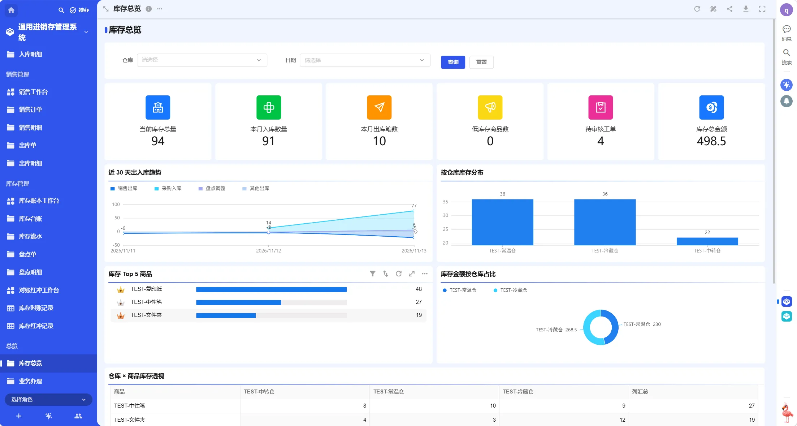

**3. 业务办理页**（快捷发起 + 今日待办）

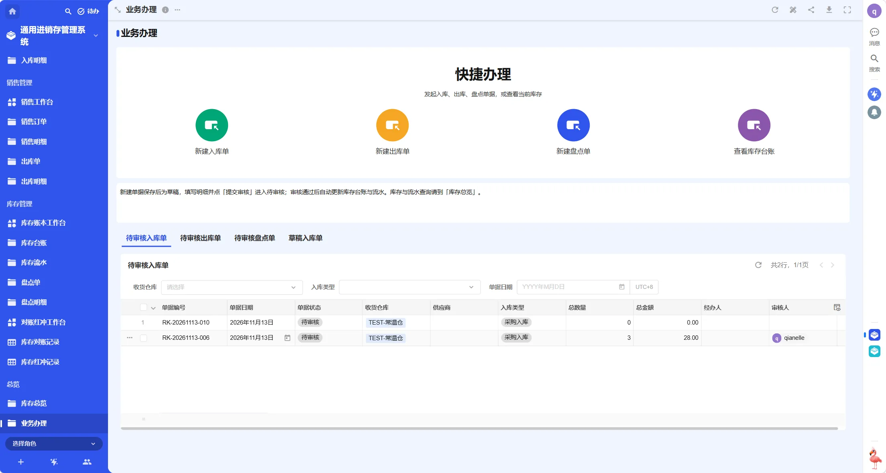

**4. 商品档案详情**（当前总库存跨仓汇总、安全库存、库存预警）

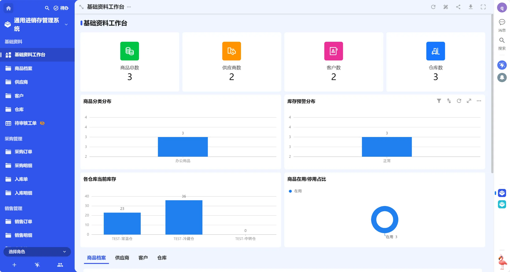

**5. 采购订单详情**（自动编号、采购明细子表、总数量 / 总金额汇总）

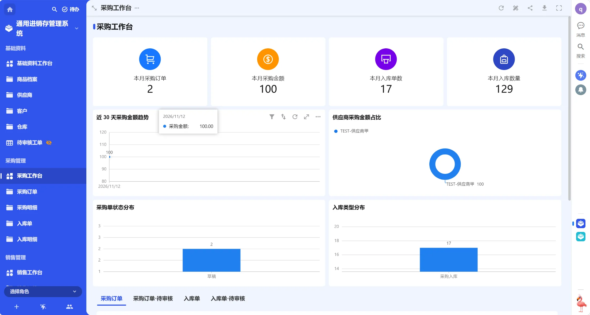

**6. 入库单详情**（关联采购订单、入库明细、W1 过账结果）

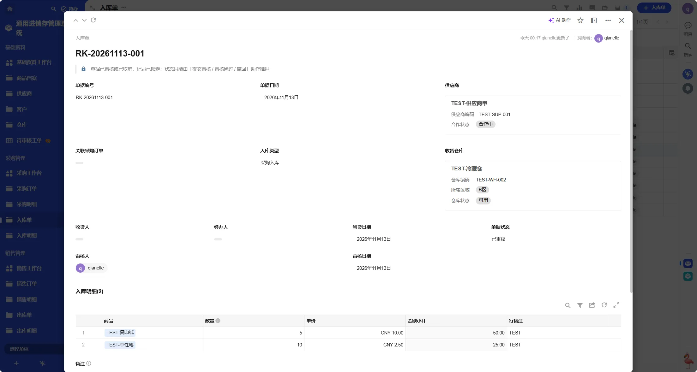

**7. 出库单详情**

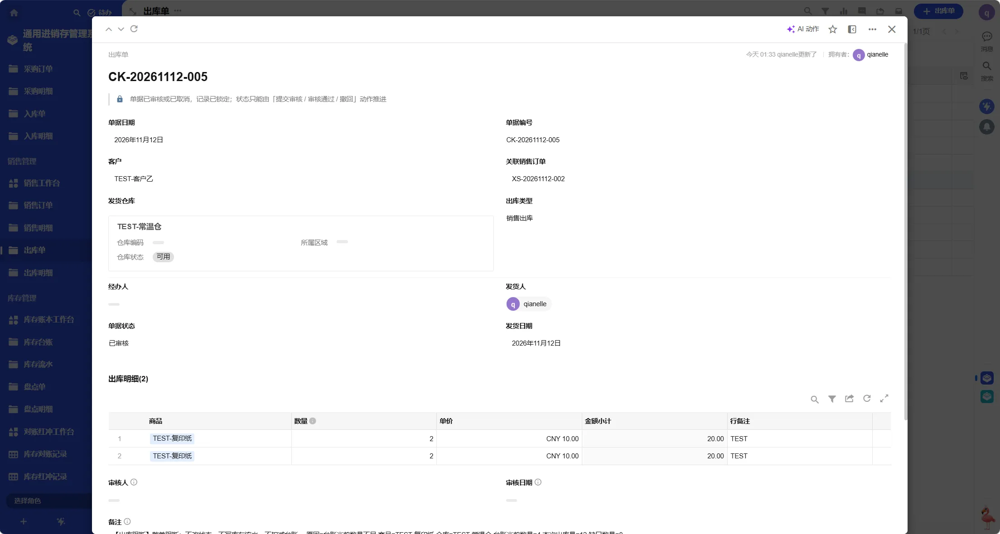

**8. 盘点单详情**

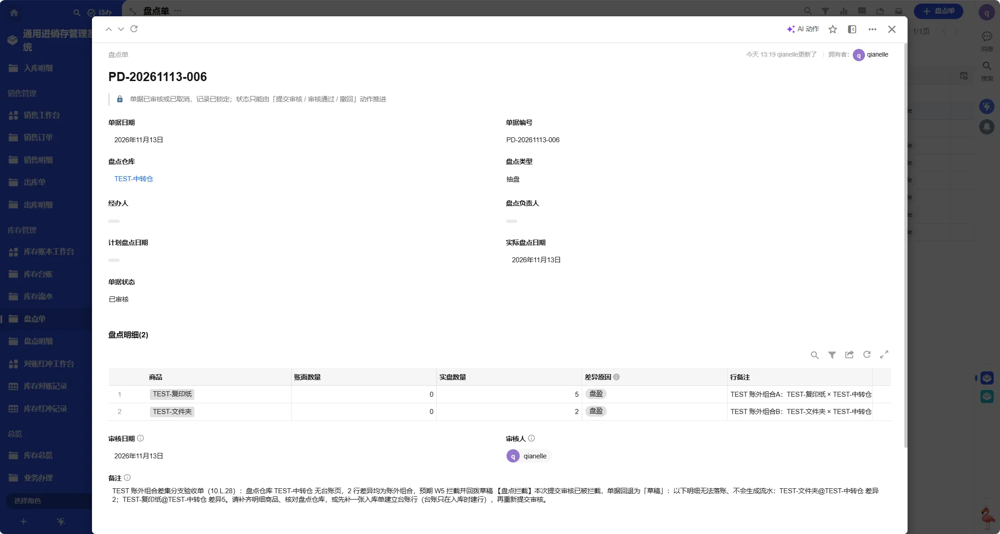

**9. 库存台账详情**（台账全称、当前数量、安全库存引用、库存金额）

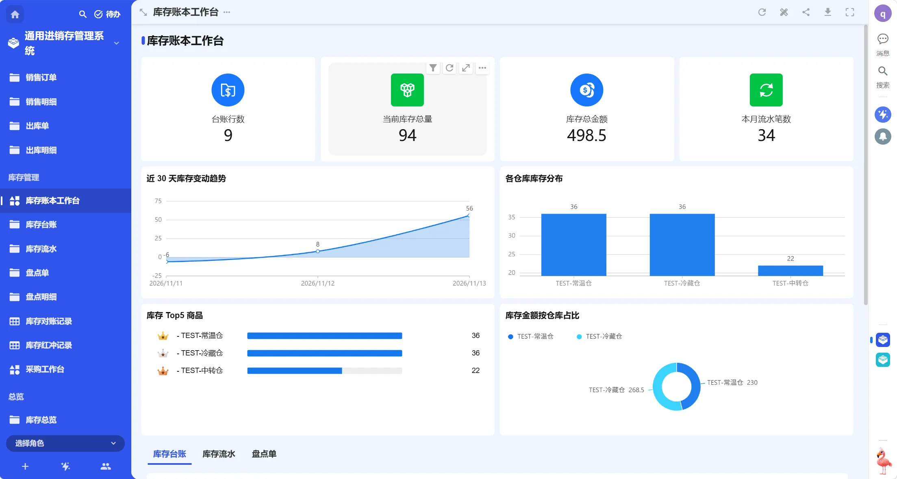

**10. 库存流水**

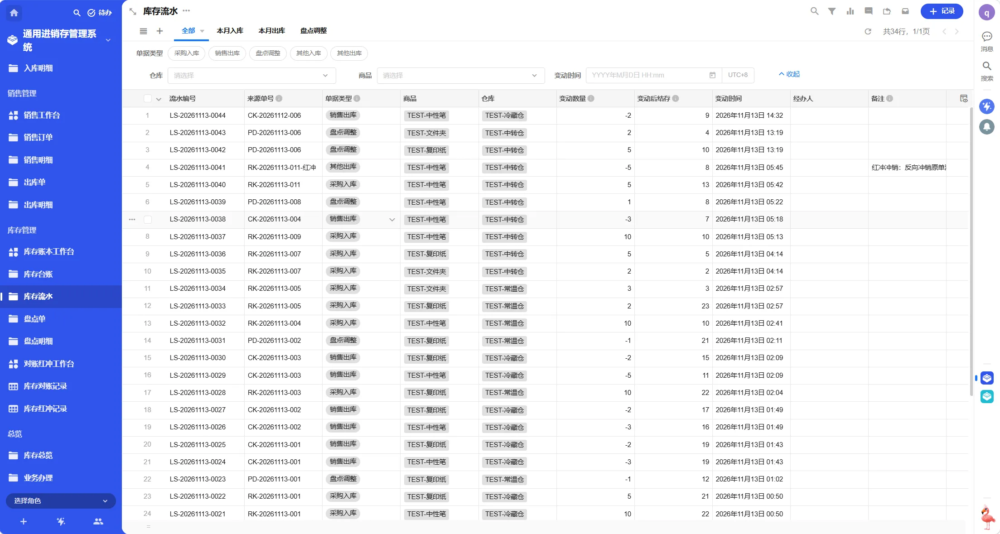

**11. 库存对账与红冲**（每日对账记录、红冲冲销留痕）

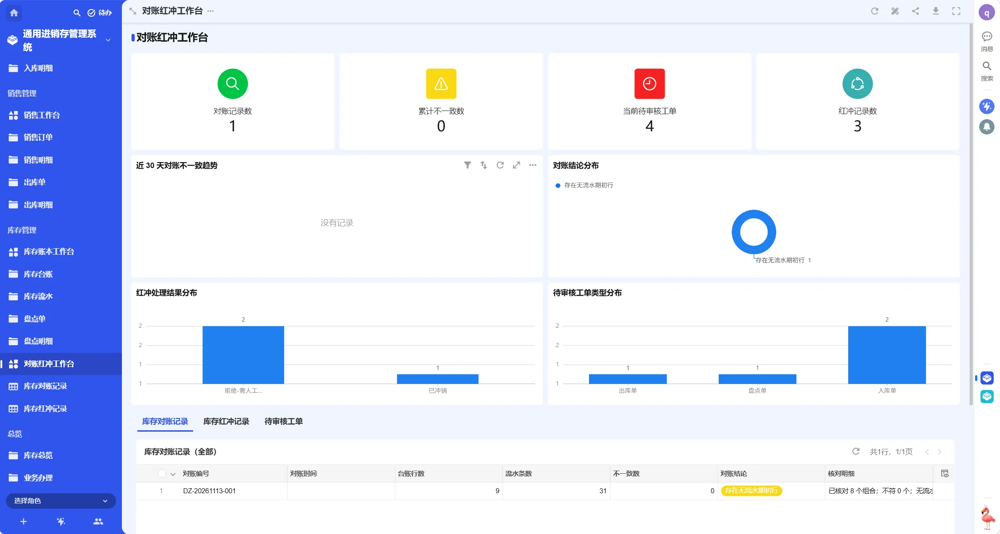

**12. 工作流画布与角色权限**（出库整单分组校验 / 仓库管理员字段屏蔽）

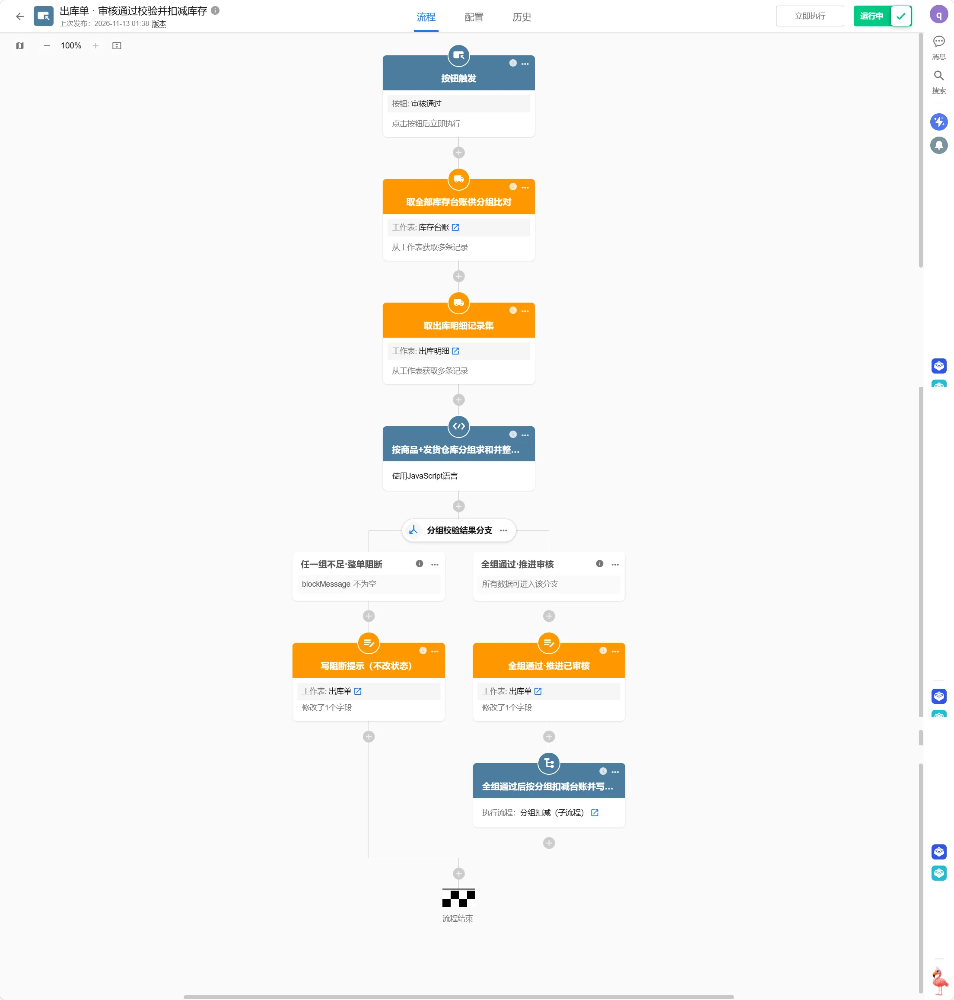

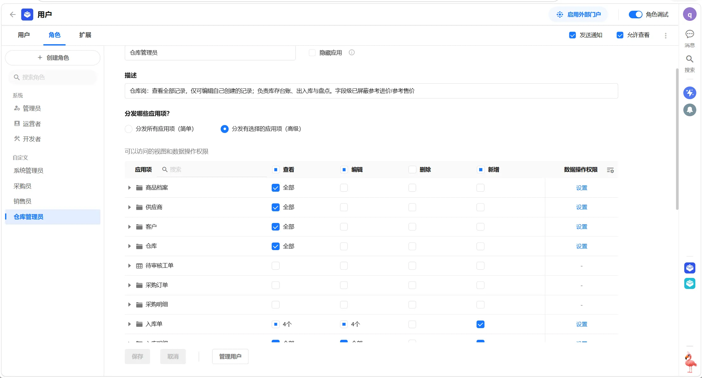

​
