# 电商 VOC 消费者风险反馈监控与处理闭环系统

### 基于 RPA + PostgreSQL + n8n + Dify + 飞书多维表的电商业务自动化实践

***

# 01｜项目概览

**业务对象**

电商客服 / 电商运营

**核心能力**

评价采集 · 数据标准化 · 风险识别 · 自动建单 · 人工跟进 · SLA 提醒

**项目性质**

个人作品Demo｜模拟电商商家后台｜已完成端到端流程验证

**项目介绍**

本项目围绕**电商消费者风险反馈的发现与处理闭环**进行设计。相比单纯对评价进行好坏分类，项目更关注如何从日常评价、追评等消费者反馈中识别需要业务人员介入的潜在风险，并将识别结果转化为可分配、可跟踪的业务工单。

系统通过影刀 RPA 定时从模拟商家后台采集评价，由 n8n 编排数据入库、去重、标准化及风险分析流程。风险判断采用**规则优先、AI 辅助**的方式：对于规则难以明确判断的复杂语义，调用 Dify 进行辅助分析，再由最终决策层整合与校验结果。

识别出的 P0/P1 风险评价自动同步至飞书，生成对应风险工单，并支持人工分配负责人、记录处理进展、跟踪处理状态及 SLA 超时提醒。

**项目目标并非替代人工完成最终业务判断，而是将原本依赖人工逐条查看、容易遗漏或缺少持续跟进的消费者风险反馈，转化为一套可发现、可分配、可追踪的自动化处理流程。**

***

# 02｜业务背景与问题

### &#x20;业务现状

在电商日常运营中，店铺会持续产生首评、追评等消费者反馈。运营或客服通常需要进入商家后台或商品评价页面进行查看，并关注其中涉及**商品质量、使用体验、物流、服务等问题**的内容。

评价查看本身并不是复杂工作，但它通常夹杂在大量日常运营任务中，比较依赖业务人员主动检查和个人经验。对于普通评价，人工能够较快判断；但如果消费者表达比较模糊、问题分散在追评中，或者评价数量增加，就可能出现风险反馈发现不及时的情况。

### &#x20;核心问题

**① 风险反馈发现依赖人工，容易出现遗漏。**

人工查看评价需要持续投入时间，发现效率受检查频率影响。对于表达模糊、隐藏在追评中或无法通过简单规则识别的问题，业务人员可能无法及时发现。

**② 风险发现后，缺少统一、可追踪的处理机制。**

在缺少统一工单机制的情况下，风险问题可能通过聊天、口头沟通或临时记录流转，容易出现负责人不明确、处理进度难跟踪、超时后缺少提醒等情况。

**③ 消费者反馈缺少结构化沉淀。**

如果评价处理仅停留在“查看—沟通—结束”，缺少统一的风险分类、处理记录和结果留存，就不利于后续统计高频问题、追踪同类风险和开展业务复盘。

### 项目切入点

针对上述问题，本项目选择从**消费者风险反馈的自动发现与处理跟进**切入，而不是单纯实现评价情感分类。

项目尝试将评价数据处理、规则与 AI 辅助风险识别、风险分级和工单管理结合起来，减少对人工主动巡检的依赖，并为需要业务人员介入的问题建立统一的跟进记录。

当前以模拟电商业务环境和特定品类测试数据验证这一方案的技术链路与流程可行性，尚未验证真实生产环境中的识别效果与业务效率提升。

***

## 03｜需求分析与项目目标

围绕电商消费者评价风险管理中的核心问题，明确业务需求，并将其转化为可落地的系统能力。

| **业务痛点**            | **项目目标**      | **V1.0 实现方案**       |
| ------------------- | ------------- | ------------------- |
| **01 风险发现依赖人工**     | 自动发现消费者风险反馈   | RPA 评价采集 + 自动风险识别   |
| **02 评价风险程度不同**     | 建立统一的风险分级标准   | P0～P3 / NONE 五级风险体系 |
| **03 复杂语义难以判断**     | 兼顾识别能力与 AI 成本 | 规则优先 + Dify AI 辅助分析 |
| **04 风险处理缺乏跟踪**     | 实现风险处理闭环      | 自动建单 + 负责人分配 + 状态追踪 |
| **05 高风险处理可能超时**    | 提升风险响应的及时性    | SLA 时限管理 + 超时提醒     |
| **06 重复执行可能产生重复数据** | 保证流程可稳定重复执行   | 多层去重 + 幂等控制         |

**V1.0 核心目标：** 构建一套从消费者评价采集、风险识别到人工处理闭环的自动化流程，减少重复操作，并提升风险反馈的可追踪性。

***

# 04｜整体解决方案与系统架构

### 设计概述：分层解耦、规则优先、AI 辅助、事实与业务协作分离。

系统采用分层架构，由 n8n 串联数据采集、风险识别和工单同步等环节；PostgreSQL 保存评价事实与分析历史，Dify 负责复杂语义判断，飞书承接人工处理闭环。

### &#x20;系统架构图

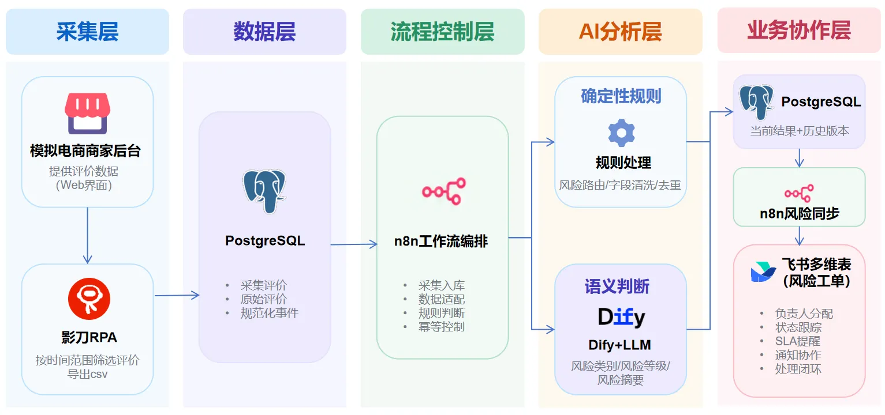

图1：系统架构图

**核心数据流：采集 → 入库 → 规范化 → 风险判断 → 分析结果沉淀 → 风险工单 → 人工处理闭环**

### 组件职责

| **组件**         | **在项目中的职责**                                 |
| -------------- | ------------------------------------------- |
| **影刀 RPA**     | 模拟人工操作商家后台，按指定时间范围筛选评价并导出 CSV，为后续流程提供数据来源   |
| **PostgreSQL** | 保存采集运行记录、原始评价、规范化事件和分析历史，作为系统的事实数据层         |
| **n8n**        | 负责工作流编排、数据清洗、去重、规则判断、幂等控制、流程路由以及不同系统之间的数据同步 |
| **Dify**       | 处理固定规则难以准确判断的评价语义，输出风险类别、风险等级、风险摘要等结构化结果    |
| **飞书多维表**      | 面向客服和主管提供风险工单、负责人分配、状态跟踪、处理备注、SLA 提醒和通知协作能力 |

***

# 05｜核心业务与技术实现

## **项目流程总览**

本项目以“一条消费者评价从商家后台进入系统，最终形成可处理风险工单”为主线，将整体流程拆分为**评价采集、数据标准化、风险初筛、AI 辅助分析、结果沉淀、风险工单同步和人工处理闭环**几个阶段。

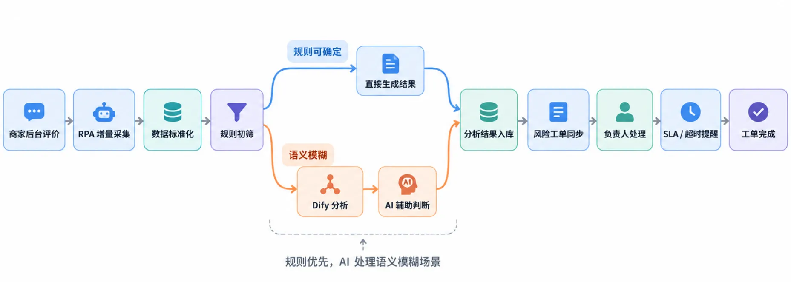

图2：项目流程总览

## **核心模块和技术实现**

### 2.1. 评价采集：从人工查看到增量采集

**业务目标：** 减少人工定期巡检评价的工作，让新增及近期更新的消费者反馈自动进入后续风险分析流程。

| **核心设计**    | **实现方式**                                        | **解决的问题**        |
| ----------- | ----------------------------------------------- | ---------------- |
| **时间窗口采集**  | 影刀 RPA 按时间范围导出 CSV，允许适度重叠                       | 减少人工操作，降低漏采风险    |
| **自动触发流程**  | CSV 导出完成后，通过 Webhook 通知 n8n                     | 采集与后续处理自动衔接      |
| **文件去重与暂存** | n8n 计算文件 Hash，跳过已成功处理的相同文件；新文件写入 PostgreSQL 暂存层 | 避免同文件重复入库，保留来源记录 |

​

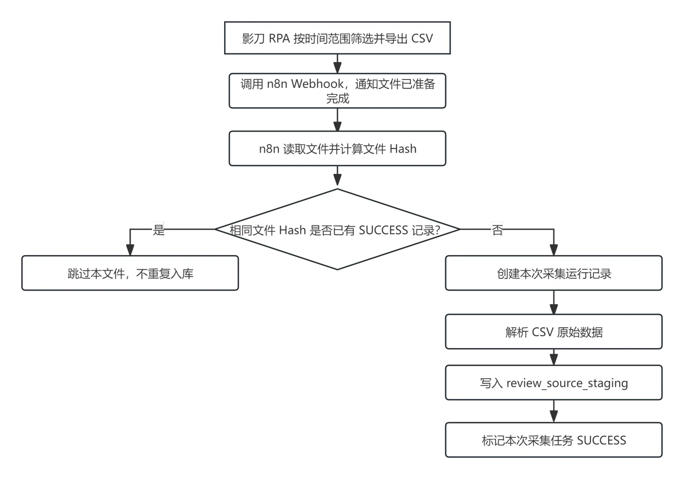

图3：评价采集入库流程

### 2.2. 数据标准化：从“后台一行记录”到“统一评价事件”

**业务目标：** 将后台来源记录转换为统一、可独立分析的评价事件，降低后续风险分析对平台原始字段结构的依赖。

| **核心设计**      | **实现方式**                                      | **解决的问题**        |
| ------------- | --------------------------------------------- | ---------------- |
| **字段统一**      | Adapter 映射平台、商品、SKU、评分、评价文本及时间等字段             | 减少平台字段差异对下游流程的影响 |
| **首评 / 追评拆分** | 将同一来源记录中的首评与追评拆分为独立事件                         | 避免新反馈被原有评价掩盖     |
| **事件标识与去重**   | 生成 content\_id、content\_key，去重后写入raw\_reviews | 避免重复事件，支持独立分析与追溯 |

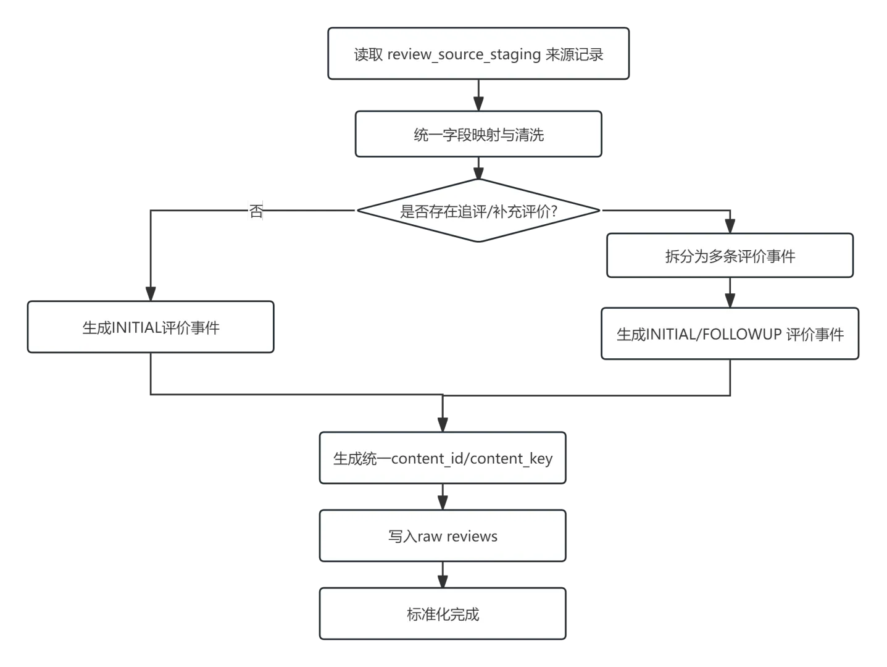

图4：数据标准化及评价拆分流程

**设计说明：**&#x72;eview\_source\_staging 保留来源记录，raw\_reviews 存储标准化评价事件；content\_id 区分具体事件，content\_key 用于唯一标识与去重。

### 2.3. 风险初筛：确定性问题优先由规则处理

**业务目标：** 优先通过规则识别风险明确的评价，仅对规则难以判断的内容调用 AI，兼顾识别效率、成本与风险控制。

| **核心设计**    | **实现方式**                                | **解决的问题**            |
| ----------- | --------------------------------------- | -------------------- |
| **分析范围筛选**  | 判断评价是否属于监控范围，范围外标记 OUT\_OF\_SCOPE       | 避免无关内容进入分析           |
| **确定性规则判断** | n8n JavaScript 规则引擎匹配关键词、上下文及规则优先级      | 明确问题由代码直接处理，减少 AI 调用 |
| **复杂评价分流**  | 对无法稳定判断的评价设置 need\_ai = true，进入 Dify 分析 | 避免规则强行定级造成误判         |

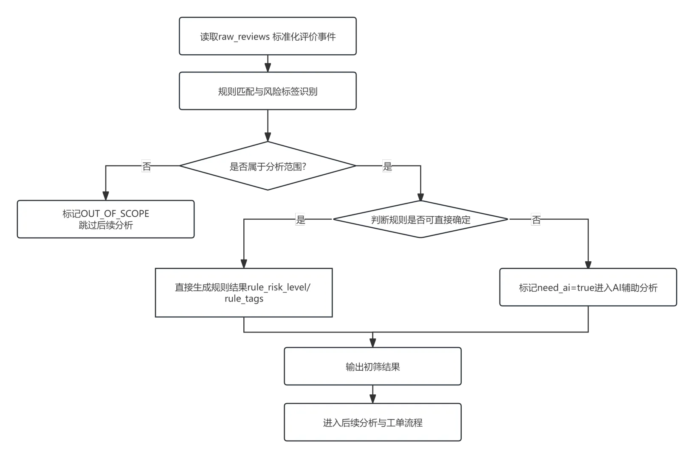

图5：评价规则判断处理流程

**设计说明：** 系统采用 P0、P1、P2、P3、NONE 风险等级体系；当前 Demo 使用 rules-supplement-v1.0版本规则。高风险硬规则优先保留，不能被 AI 的低风险判断直接覆盖。

### 2.4. **AI 辅助分析：处理语义模糊的消费者反馈**

**业务目标：** 利用 AI 的上下文理解能力，辅助识别规则难以判断的消费者反馈，减少因表达模糊、语义复杂造成的风险误判与漏判。

| **核心设计**    | **实现方式**                                   | **解决的问题**              |
| ----------- | ------------------------------------------ | ---------------------- |
| **上下文信息输入** | n8n 整理评价文本、评分、商品信息及规则初筛结果，传入 Dify          | 避免仅凭关键词判断，提供必要分析依据     |
| **AI 语义分析** | Dify 调用大模型，输出风险类别、等级、摘要及情绪等结构化结果           | 识别模糊表达、混合问题和潜在风险       |
| **结果校验与决策** | n8n 校验 AI 输出，并通过 Final Decision 结合规则确定最终结论 | 防止异常输出或 AI 判断直接覆盖高风险规则 |

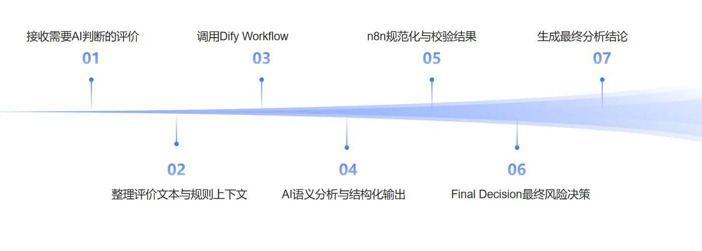

图6：AI辅助分析语义流程

**设计说明：** AI 负责复杂语义的辅助理解，最终风险结论由固定决策逻辑确定；已命中的高风险硬规则不能被 AI 直接降级。

**2.5. 结果沉淀：保存当前判断并保留分析历史**

**业务目标：** 统一保存风险分析结果，保留历史判断，确保后续工单始终使用当前有效版本。

| **核心设计**   | **实现方式**                                         | **作用**        |
| ---------- | ------------------------------------------------ | ------------- |
| **分析结果入库** | 将风险等级、摘要、决策来源等结果写入 PostgreSQL analysis\_results表 | 统一保存分析结论      |
| **当前结果标识** | 使用 is\_current标记当前有效版本                           | 确保后续业务只使用最新结果 |
| **历史结果保留** | 新结果写入后，旧结果不直接覆盖删除                                | 支持结果追溯与后续复盘   |

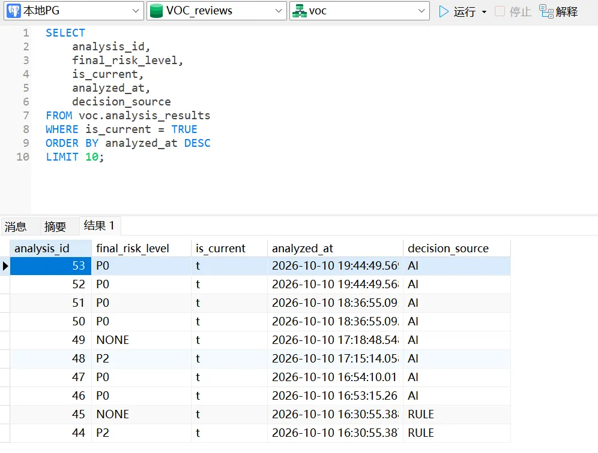

图7：PostgreSQL 分析结果存储示例

**设计说明：** 当前 Demo 已验证分析结果可以稳定写入 analysis\_results 表，并通过 is\_current 标识当前有效结果。系统设计上支持同一评价在规则调整或重新分析后生成新的分析版本，同时保留历史记录，用于结果追溯和规则优化。

**2.6. 风险工单同步：将需要业务介入的评价转为工单**

**业务目标：** 将 P0/P1 风险评价自动同步至飞书处理台，并根据最新风险判断维护工单，避免重复建单和人工信息丢失。

| **同步动作**           | **触发条件**          | **处理结果**       |
| ------------------ | ----------------- | -------------- |
| **CREATE（创建）**     | 首次达到 P0/P1 风险处理条件 | 自动创建风险工单       |
| **UPDATE（更新）**     | 已有工单的风险信息发生变化     | 更新原工单，不重复创建    |
| **INVALIDATE（失效）** | 最新结果不再满足风险处理条件    | 标记“已失效”，保留历史记录 |
| **NOOP（无需操作）**     | 无需新增或更新工单         | 跳过写入，避免重复操作    |

**技术实现：** n8n 通过 VOC\_03\_FeishuRiskSync工作流读取 PostgreSQL 当前分析结果，与飞书现有工单进行比对，根据 alert\_key 判断同步动作，并通过飞书 API 完成写入。

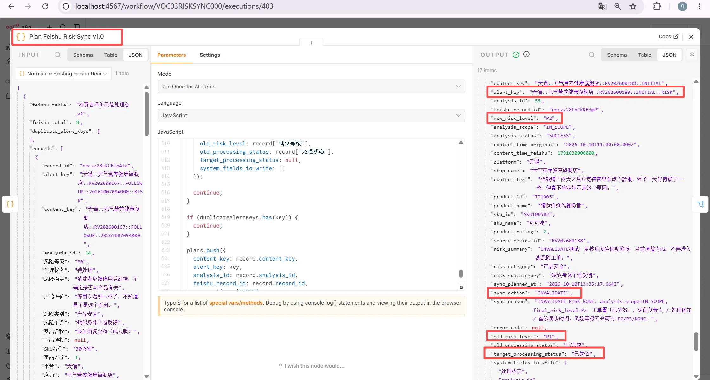

图8：风险变化与同步动作

> 当系统检测到某条评价的最新风险等级由 P1 变为 P2 时，已不再满足当前 Demo 的风险建单条件，因此 n8n 判断本次同步动作为INVALIDATE，并将目标工单状态更新为“已失效”。这样既能避免业务人员继续处理无效工单，也能保留原有工单历史与人工处理记录。

**设计说明：**&#x61;lert\_key用于识别同一风险工单；系统仅更新其负责的字段，保留负责人、处理备注等人工信息，避免自动同步覆盖客服处理记录

### 2.7. 人工处理闭环：从“发现风险”进入“解决风险”

**业务目标：** 将自动识别的风险转化为可分配、可跟进、可提醒、可关闭的业务工单，避免风险发现后无人处理或处理进度无法追踪。

| **核心机制**      | **实现方式**                             | **解决的问题**    |
| ------------- | ------------------------------------ | ------------ |
| **风险通知与分配**   | 飞书自动通知主管，负责人确定或变更后通知对应人员             | 避免风险无人认领     |
| **SLA 时限与提醒** | P0：1 小时；P1：4 小时。按首次风险等级计算时限，到期后按条件提醒 | 降低超时无人跟进的风险  |
| **处理状态闭环**    | 客服更新状态与备注，完成时自动记录时间；失效工单保留记录         | 让处理进度可追踪、可复盘 |

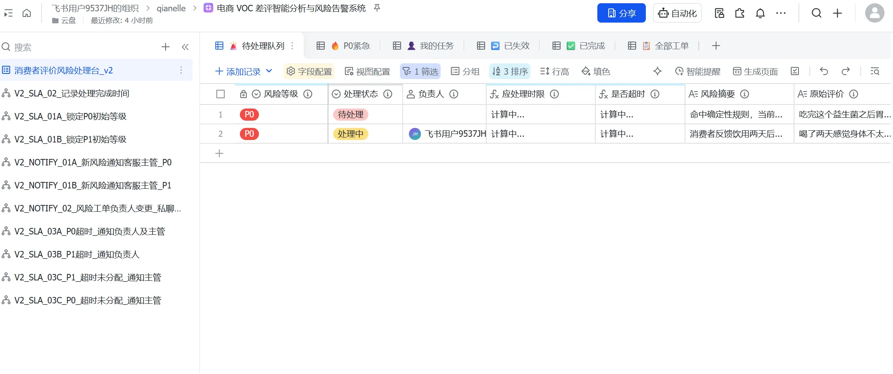

**​**

图9：飞书风险工单处理台

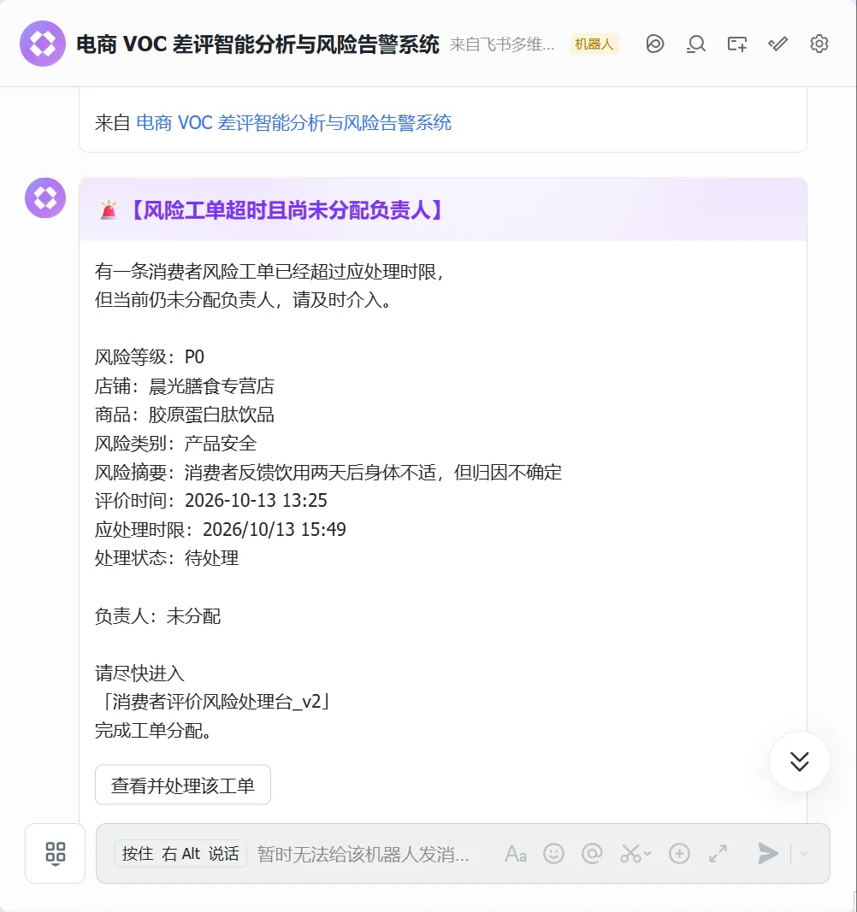

图10；飞书自动化通知与 SLA 提醒

**设计说明：** SLA 时限依据工单首次风险等级锁定，不随重新分析随意延长；超时提醒通过处理状态与首次提醒记录控制重复触发。“已完成”表示人工处理结束，“已失效”表示系统不再将该事项作为当前高风险工单。

***

# 06｜项目演示与运行效果

## 本项目为个人 Demo，使用模拟业务数据，已完成端到端流程验证，尚未经过真实生产环境验证。

点击链接看完整[<u>演示视频</u>](https://b23.tv/l7CYhJr)​

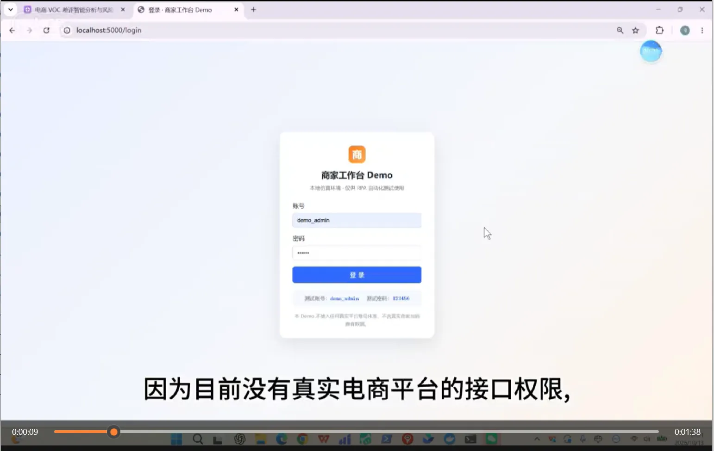

***

# 07｜项目边界、不足与生产化改进

本项目已在模拟业务环境中完成端到端流程验证，但尚未经过真实生产环境、长期运行及业务效果验证。在开发与试用过程中，也发现了以下不足和改进方向。

| **维度**        | **当前不足**                                                | **后续改进方向**                                           |
| ------------- | ------------------------------------------------------- | ---------------------------------------------------- |
| **真实数据接入**    | 当前使用仿真商家后台与模拟评价数据，尚未接入真实电商平台。                           | 在获得授权的前提下评估官方 API 接入，完善采集异常处理与跨平台字段适配。               |
| **技术选型与部署**   | Dify 主要承担单次语义分析，却增加了独立部署与维护成本，本地运行中也曾出现服务异常。            | 对简单任务优先评估 n8n 直接调用模型 API；确有复杂 AI 工作流或知识库需求时再引入 Dify。 |
| **风险识别与人工复核** | 风险规则和测试样本集中于特定品类，缺少真实数据验证；已有人工跟进流程，但尚未实现独立的风险判断复核与反馈机制。 | 结合人工标注样本评估误报、漏报情况，建立风险复核与反馈机制，持续优化规则和 AI 判断。         |
| **业务使用体验**    | 飞书已支持自动建单、人工跟进与 SLA 提醒，但订单编号未传递至工单，部分处理操作较繁琐。           | 完善订单信息传递与客服操作界面，通过小范围业务试用优化处理流程。                     |
| **可靠性与运维**    | 已完成核心流程验证，但缺少长期运行和故障恢复测试；代码排查中发现风险升级可能重置人工处理状态。         | 完善异常监控、失败重试和状态保护机制，通过持续运行及 SLA 等指标评估系统表现。            |

## 项目范围与功能取舍

项目最初设想是整合**客服接待明细、消费者评价及商品「问大家」等多渠道反馈**，用于风险识别、商品卖点提炼、运营问题分析和产品迭代建议。

但在实际开发过程中，我发现同时实现多个业务场景容易导致需求不断扩张，增加开发、测试和维护成本。因此，V1 选择以**评价风险识别与工单处理**作为最小验证场景，优先完成一条可运行的端到端业务链路，而非一次性实现完整的 VOC 系统。

同时，现有电商客服工具已具备一定的工单管理能力，后续应优先调研和复用成熟方案，避免重复建设。若继续扩展，将更关注多来源消费者反馈的整合分析，以及如何将反馈转化为商品运营和产品优化的依据，而不是单纯增加自动化功能。

**项目反思：** 这次实践让我认识到，AI 自动化项目不仅要关注技术能否实现，还应重视现有方案调研、业务价值验证及项目范围控制，优先解决明确的问题，再根据实际需求决定是否扩展。

​

​
